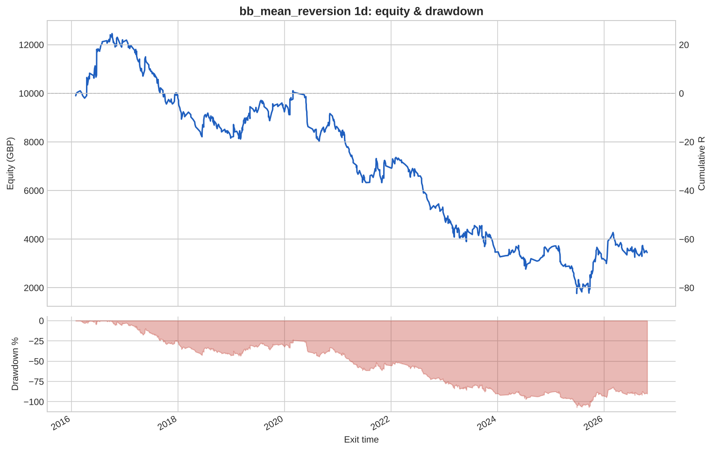
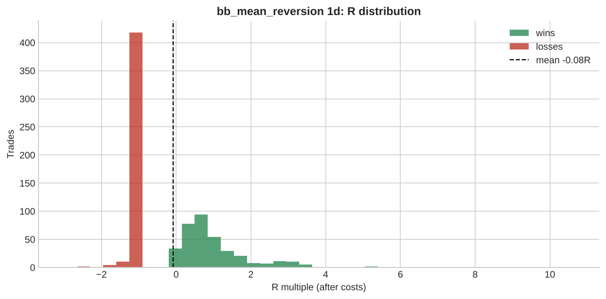

# bb_mean_reversion 1d

**Parameters:** period=20, std=2.0, adx_max=20, sl_atr_buffer=0.5, max_bars=30

**Costs modelled:** spread per instrument (config), slippage 0.2 pips/pts per side, commission 0.0 GBP/round trip, same-bar SL+TP → pessimistic.  
**Sizing:** 1.0% of GBP 10,000 per trade, fixed.

## Headline

| Metric | Value |
|---|---|
| Trades | 798 |
| Win rate | 45.1% |
| Expectancy (R) | -0.082 |
| Profit factor | 0.856 |
| Payoff ratio | 1.041 |
| Total R | -65.537 |
| Return % | -65.537 |
| Max drawdown (R) | 107.0 |
| Max drawdown % | 107.0 |
| Sharpe (daily) | -0.507 |
| t-stat of mean R | -1.744 |
| Avg bars held | 4.016 |
| Max consecutive losses | 14 |
| Trades / month | 6.195 |
| First trade | 2016-01-27 |
| Last trade | 2026-10-22 |

## By instrument

| instrument | trades | win_rate | expectancy_R | total_R | max_dd_R |
|---|---|---|---|---|---|
| AUDUSD | 59 | 0.508 | -0.059 | -3.505 | 13.320 |
| EURGBP | 49 | 0.571 | 0.184 | 9.038 | 3.369 |
| EURJPY | 48 | 0.479 | -0.234 | -11.237 | 12.276 |
| EURUSD | 49 | 0.449 | -0.193 | -9.477 | 13.942 |
| GBPJPY | 47 | 0.340 | -0.546 | -25.646 | 25.646 |
| GBPUSD | 54 | 0.444 | -0.213 | -11.507 | 15.139 |
| GER40 | 71 | 0.521 | 0.138 | 9.799 | 13.684 |
| JPN225 | 52 | 0.500 | 0.196 | 10.199 | 9.214 |
| NAS100 | 50 | 0.320 | -0.149 | -7.439 | 12.909 |
| SPX500 | 57 | 0.509 | 0.082 | 4.649 | 7.536 |
| UK100 | 52 | 0.500 | -0.032 | -1.665 | 9.569 |
| US30 | 48 | 0.333 | -0.320 | -15.373 | 17.177 |
| USDCAD | 59 | 0.305 | -0.492 | -29.051 | 31.513 |
| USDCHF | 56 | 0.500 | 0.233 | 13.048 | 5.879 |
| USDJPY | 47 | 0.447 | 0.056 | 2.632 | 10.510 |

## By year

| year | trades | win_rate | expectancy_R | total_R | max_dd_R |
|---|---|---|---|---|---|
| 2016 | 65 | 0.523 | 0.323 | 21.007 | 5.577 |
| 2017 | 90 | 0.422 | -0.254 | -22.885 | 26.328 |
| 2018 | 64 | 0.328 | -0.253 | -16.205 | 16.587 |
| 2019 | 74 | 0.527 | 0.141 | 10.449 | 8.378 |
| 2020 | 71 | 0.465 | -0.085 | -6.010 | 20.834 |
| 2021 | 76 | 0.382 | -0.213 | -16.170 | 23.132 |
| 2022 | 63 | 0.365 | -0.318 | -20.059 | 23.499 |
| 2023 | 99 | 0.444 | -0.156 | -15.482 | 15.482 |
| 2024 | 56 | 0.589 | 0.024 | 1.352 | 9.320 |
| 2025 | 89 | 0.494 | -0.045 | -4.025 | 19.571 |
| 2026 | 51 | 0.431 | 0.049 | 2.492 | 10.182 |

## By direction

| direction | trades | win_rate | expectancy_R | total_R | max_dd_R |
|---|---|---|---|---|---|
| long | 347 | 0.516 | 0.009 | 3.046 | 21.548 |
| short | 451 | 0.401 | -0.152 | -68.583 | 98.179 |

## By exit reason

| exit_reason | trades | win_rate | expectancy_R | total_R | max_dd_R |
|---|---|---|---|---|---|
| open_at_end | 1 | 0.000 | -0.803 | -0.803 | 0.803 |
| stop | 435 | 0.000 | -1.042 | -453.5 | 453.5 |
| target | 357 | 1.000 | 1.086 | 387.8 | 0.000 |
| time | 5 | 0.600 | 0.185 | 0.924 | 0.281 |

## By entry hour (UTC)

| entry_hour_utc | trades | win_rate | expectancy_R | total_R | max_dd_R |
|---|---|---|---|---|---|
| 0 | 798 | 0.451 | -0.082 | -65.537 | 107.0 |

## Monte Carlo (1000 runs)

| | p50 | p95 |
|---|---|---|
| Max drawdown, shuffled order (R) | 80.6 | 102.1 |
| Max drawdown, bootstrap (R) | 84.0 | 139.7 |

Bootstrap total R: p5 -127.6, p50 -66.7, p95 -2.6. Probability the edge is actually negative: **96%**.

---

_Backtests use mid/bid prices from free feeds, one position per instrument, no overnight financing, no margin limits. They are research, not a forecast and not advice._