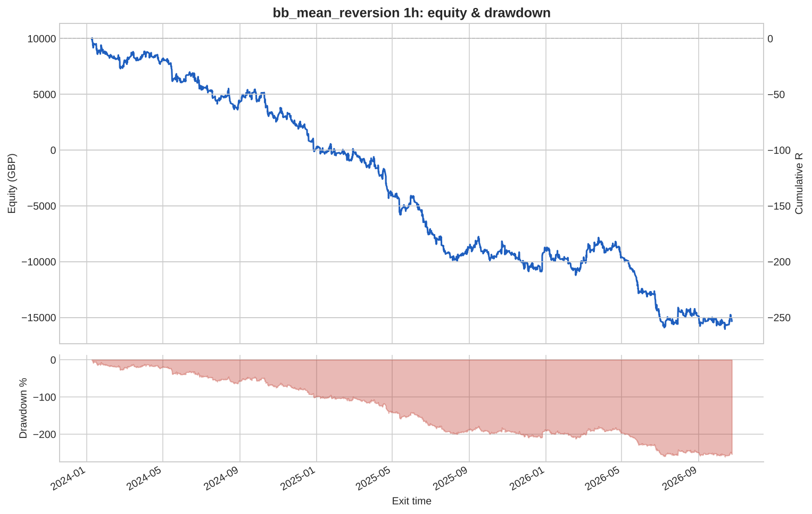
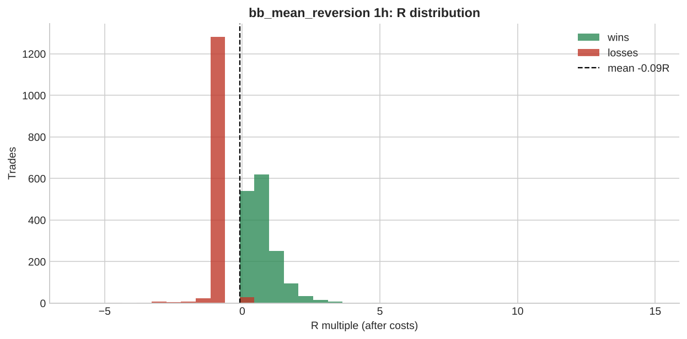

# bb_mean_reversion 1h

**Parameters:** period=20, std=2.0, adx_max=20, sl_atr_buffer=0.5, max_bars=30

**Costs modelled:** spread per instrument (config), slippage 0.2 pips/pts per side, commission 0.0 GBP/round trip, same-bar SL+TP → pessimistic.  
**Sizing:** 1.0% of GBP 10,000 per trade, fixed.

## Headline

| Metric | Value |
|---|---|
| Trades | 2,933 |
| Win rate | 53.6% |
| Expectancy (R) | -0.086 |
| Profit factor | 0.825 |
| Payoff ratio | 0.716 |
| Total R | -253.5 |
| Return % | -253.5 |
| Max drawdown (R) | 260.9 |
| Max drawdown % | 260.9 |
| Sharpe (daily) | -2.268 |
| t-stat of mean R | -4.287 |
| Avg bars held | 4.283 |
| Max consecutive losses | 15 |
| Trades / month | 87.359 |
| First trade | 2024-01-05 |
| Last trade | 2026-10-23 |

> Return below -100%: with fixed-size risk this strategy would have emptied the account. Read the R figures; the % is just arithmetic.

## By instrument

| instrument | trades | win_rate | expectancy_R | total_R | max_dd_R |
|---|---|---|---|---|---|
| AUDUSD | 293 | 0.505 | -0.146 | -42.906 | 46.717 |
| EURGBP | 282 | 0.624 | 0.025 | 7.093 | 13.192 |
| EURJPY | 278 | 0.543 | -0.039 | -10.807 | 25.934 |
| EURUSD | 278 | 0.482 | -0.155 | -43.189 | 46.308 |
| GBPJPY | 308 | 0.565 | -0.054 | -16.774 | 30.566 |
| GBPUSD | 276 | 0.518 | -0.049 | -13.556 | 35.851 |
| GER40 | 89 | 0.393 | -0.294 | -26.195 | 30.963 |
| JPN225 | 36 | 0.361 | -0.265 | -9.554 | 12.005 |
| NAS100 | 51 | 0.451 | -0.334 | -17.055 | 20.180 |
| SPX500 | 48 | 0.458 | -0.295 | -14.147 | 16.928 |
| UK100 | 80 | 0.500 | -0.015 | -1.240 | 15.905 |
| US30 | 72 | 0.417 | -0.187 | -13.499 | 18.922 |
| USDCAD | 270 | 0.611 | -0.050 | -13.533 | 21.404 |
| USDCHF | 315 | 0.584 | -0.060 | -18.871 | 29.940 |
| USDJPY | 257 | 0.518 | -0.075 | -19.247 | 24.752 |

## By year

| year | trades | win_rate | expectancy_R | total_R | max_dd_R |
|---|---|---|---|---|---|
| 2024 | 1,027 | 0.547 | -0.095 | -97.075 | 101.7 |
| 2025 | 1,065 | 0.529 | -0.087 | -92.349 | 114.5 |
| 2026 | 841 | 0.530 | -0.076 | -64.056 | 82.079 |

## By direction

| direction | trades | win_rate | expectancy_R | total_R | max_dd_R |
|---|---|---|---|---|---|
| long | 1,310 | 0.550 | -0.074 | -97.567 | 106.7 |
| short | 1,623 | 0.524 | -0.096 | -155.9 | 182.6 |

## By exit reason

| exit_reason | trades | win_rate | expectancy_R | total_R | max_dd_R |
|---|---|---|---|---|---|
| open_at_end | 1 | 1.000 | 0.003 | 0.003 | 0.000 |
| stop | 1,329 | 0.000 | -1.091 | -1,450.1 | 1,450.1 |
| target | 1,588 | 0.982 | 0.752 | 1,193.5 | 0.068 |
| time | 15 | 0.667 | 0.212 | 3.180 | 0.688 |

## By entry hour (UTC)

| entry_hour_utc | trades | win_rate | expectancy_R | total_R | max_dd_R |
|---|---|---|---|---|---|
| 0 | 25 | 0.680 | 0.035 | 0.886 | 3.145 |
| 1 | 32 | 0.594 | -0.066 | -2.116 | 4.522 |
| 2 | 74 | 0.554 | -0.052 | -3.862 | 13.645 |
| 3 | 109 | 0.495 | -0.119 | -13.023 | 21.038 |
| 4 | 80 | 0.438 | -0.227 | -18.129 | 18.943 |
| 5 | 56 | 0.357 | -0.280 | -15.666 | 23.798 |
| 6 | 71 | 0.479 | -0.035 | -2.455 | 14.098 |
| 7 | 91 | 0.505 | -0.185 | -16.825 | 20.636 |
| 8 | 105 | 0.590 | -0.097 | -10.181 | 20.394 |
| 9 | 170 | 0.618 | -0.041 | -7.030 | 12.905 |
| 10 | 204 | 0.534 | -0.123 | -25.189 | 31.408 |
| 11 | 207 | 0.522 | -0.125 | -25.948 | 36.564 |
| 12 | 182 | 0.516 | -0.055 | -10.068 | 24.035 |
| 13 | 157 | 0.548 | -0.124 | -19.499 | 25.934 |
| 14 | 197 | 0.584 | -0.106 | -20.851 | 32.379 |
| 15 | 226 | 0.584 | -0.048 | -10.945 | 16.037 |
| 16 | 220 | 0.541 | -0.143 | -31.444 | 38.902 |
| 17 | 229 | 0.546 | -0.039 | -8.984 | 25.631 |
| 18 | 154 | 0.494 | -0.174 | -26.821 | 41.162 |
| 19 | 115 | 0.496 | -0.067 | -7.718 | 12.757 |
| 20 | 80 | 0.612 | 0.194 | 15.493 | 6.528 |
| 21 | 78 | 0.449 | 0.028 | 2.184 | 11.615 |
| 22 | 45 | 0.400 | 0.085 | 3.822 | 9.836 |
| 23 | 26 | 0.577 | 0.034 | 0.889 | 4.979 |

## Monte Carlo (1000 runs)

| | p50 | p95 |
|---|---|---|
| Max drawdown, shuffled order (R) | 263.9 | 282.0 |
| Max drawdown, bootstrap (R) | 266.8 | 366.1 |

Bootstrap total R: p5 -355.2, p50 -251.7, p95 -150.8. Probability the edge is actually negative: **100%**.

---

_Backtests use mid/bid prices from free feeds, one position per instrument, no overnight financing, no margin limits. They are research, not a forecast and not advice._