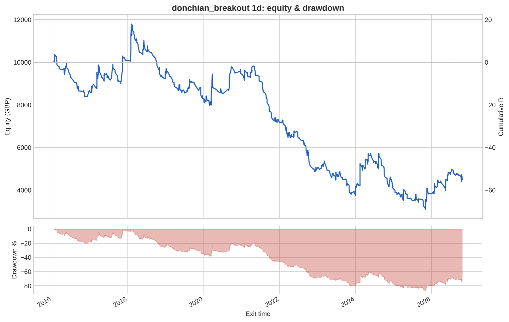
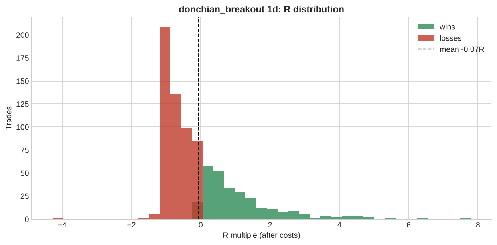

# donchian_breakout 1d

**Parameters:** lookback=20, adx_min=20, sl_atr=2.0, trail_atr=2.0, rr=None, max_bars=200

**Costs modelled:** spread per instrument (config), slippage 0.2 pips/pts per side, commission 0.0 GBP/round trip, same-bar SL+TP → pessimistic.  
**Sizing:** 1.0% of GBP 10,000 per trade, fixed.

## Headline

| Metric | Value |
|---|---|
| Trades | 813 |
| Win rate | 34.1% |
| Expectancy (R) | -0.066 |
| Profit factor | 0.855 |
| Payoff ratio | 1.655 |
| Total R | -53.659 |
| Return % | -53.659 |
| Max drawdown (R) | 87.105 |
| Max drawdown % | 87.105 |
| Sharpe (daily) | -0.422 |
| t-stat of mean R | -1.630 |
| Avg bars held | 14.317 |
| Max consecutive losses | 26 |
| Trades / month | 6.275 |
| First trade | 2016-01-04 |
| Last trade | 2026-10-22 |

## By instrument

| instrument | trades | win_rate | expectancy_R | total_R | max_dd_R |
|---|---|---|---|---|---|
| AUDUSD | 43 | 0.279 | -0.351 | -15.098 | 17.506 |
| EURGBP | 41 | 0.317 | -0.190 | -7.805 | 10.456 |
| EURJPY | 50 | 0.320 | -0.203 | -10.152 | 12.434 |
| EURUSD | 48 | 0.292 | -0.215 | -10.297 | 13.566 |
| GBPJPY | 48 | 0.354 | -0.004 | -0.197 | 4.130 |
| GBPUSD | 49 | 0.286 | -0.145 | -7.123 | 10.956 |
| GER40 | 56 | 0.393 | -0.109 | -6.076 | 11.450 |
| JPN225 | 59 | 0.424 | 0.244 | 14.403 | 5.719 |
| NAS100 | 78 | 0.385 | 0.047 | 3.680 | 7.204 |
| SPX500 | 67 | 0.373 | 0.123 | 8.256 | 7.273 |
| UK100 | 66 | 0.242 | -0.286 | -18.877 | 20.813 |
| US30 | 66 | 0.394 | 0.153 | 10.117 | 10.452 |
| USDCAD | 51 | 0.294 | -0.131 | -6.704 | 16.370 |
| USDCHF | 45 | 0.356 | -0.193 | -8.705 | 8.705 |
| USDJPY | 46 | 0.348 | 0.020 | 0.920 | 6.783 |

## By year

| year | trades | win_rate | expectancy_R | total_R | max_dd_R |
|---|---|---|---|---|---|
| 2016 | 60 | 0.300 | -0.222 | -13.321 | 19.866 |
| 2017 | 77 | 0.377 | 0.186 | 14.354 | 9.409 |
| 2018 | 86 | 0.326 | -0.062 | -5.301 | 25.744 |
| 2019 | 74 | 0.378 | -0.167 | -12.384 | 13.891 |
| 2020 | 72 | 0.417 | 0.157 | 11.324 | 8.780 |
| 2021 | 80 | 0.250 | -0.285 | -22.833 | 26.444 |
| 2022 | 80 | 0.325 | -0.277 | -22.173 | 24.312 |
| 2023 | 65 | 0.308 | -0.171 | -11.090 | 15.682 |
| 2024 | 94 | 0.319 | 0.025 | 2.348 | 16.388 |
| 2025 | 60 | 0.317 | -0.046 | -2.759 | 10.050 |
| 2026 | 65 | 0.446 | 0.126 | 8.175 | 5.468 |

## By direction

| direction | trades | win_rate | expectancy_R | total_R | max_dd_R |
|---|---|---|---|---|---|
| long | 417 | 0.400 | 0.138 | 57.457 | 21.388 |
| short | 396 | 0.278 | -0.281 | -111.1 | 115.3 |

## By exit reason

| exit_reason | trades | win_rate | expectancy_R | total_R | max_dd_R |
|---|---|---|---|---|---|
| open_at_end | 2 | 0.500 | 0.510 | 1.021 | 0.517 |
| stop | 129 | 0.000 | -1.019 | -131.5 | 131.5 |
| trail_stop | 682 | 0.405 | 0.113 | 76.813 | 29.444 |

## By entry hour (UTC)

| entry_hour_utc | trades | win_rate | expectancy_R | total_R | max_dd_R |
|---|---|---|---|---|---|
| 0 | 813 | 0.341 | -0.066 | -53.659 | 87.105 |

## Monte Carlo (1000 runs)

| | p50 | p95 |
|---|---|---|
| Max drawdown, shuffled order (R) | 67.6 | 85.1 |
| Max drawdown, bootstrap (R) | 66.4 | 115.5 |

Bootstrap total R: p5 -105.7, p50 -51.0, p95 +5.2. Probability the edge is actually negative: **94%**.

---

_Backtests use mid/bid prices from free feeds, one position per instrument, no overnight financing, no margin limits. They are research, not a forecast and not advice._