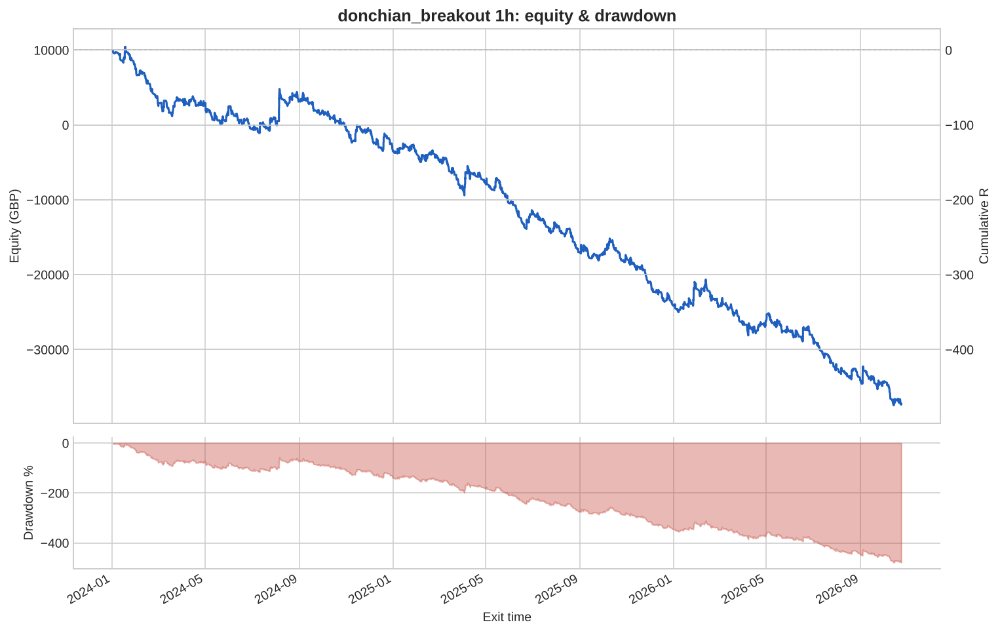
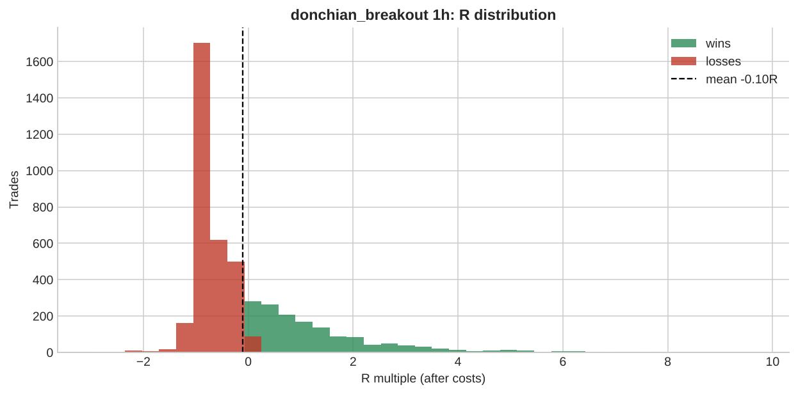

# donchian_breakout 1h

**Parameters:** lookback=20, adx_min=20, sl_atr=2.0, trail_atr=2.0, rr=None, max_bars=200

**Costs modelled:** spread per instrument (config), slippage 0.2 pips/pts per side, commission 0.0 GBP/round trip, same-bar SL+TP → pessimistic.  
**Sizing:** 1.0% of GBP 10,000 per trade, fixed.

## Headline

| Metric | Value |
|---|---|
| Trades | 4,591 |
| Win rate | 32.3% |
| Expectancy (R) | -0.103 |
| Profit factor | 0.801 |
| Payoff ratio | 1.678 |
| Total R | -472.5 |
| Return % | -472.5 |
| Max drawdown (R) | 478.8 |
| Max drawdown % | 478.8 |
| Sharpe (daily) | -2.391 |
| t-stat of mean R | -5.633 |
| Avg bars held | 13.669 |
| Max consecutive losses | 30 |
| Trades / month | 136.3 |
| First trade | 2024-01-02 |
| Last trade | 2026-10-23 |

> Return below -100%: with fixed-size risk this strategy would have emptied the account. Read the R figures; the % is just arithmetic.

## By instrument

| instrument | trades | win_rate | expectancy_R | total_R | max_dd_R |
|---|---|---|---|---|---|
| AUDUSD | 427 | 0.295 | -0.171 | -73.194 | 81.700 |
| EURGBP | 384 | 0.286 | -0.295 | -113.1 | 113.1 |
| EURJPY | 388 | 0.332 | -0.104 | -40.375 | 46.504 |
| EURUSD | 441 | 0.331 | -0.122 | -53.750 | 53.750 |
| GBPJPY | 400 | 0.335 | -0.098 | -39.028 | 45.624 |
| GBPUSD | 454 | 0.315 | -0.093 | -42.085 | 44.285 |
| GER40 | 171 | 0.345 | 0.003 | 0.471 | 21.786 |
| JPN225 | 151 | 0.358 | 0.190 | 28.631 | 7.391 |
| NAS100 | 149 | 0.356 | 0.046 | 6.894 | 15.009 |
| SPX500 | 151 | 0.338 | -0.207 | -31.243 | 32.610 |
| UK100 | 175 | 0.326 | 0.027 | 4.757 | 19.186 |
| US30 | 147 | 0.333 | -0.069 | -10.197 | 25.079 |
| USDCAD | 321 | 0.340 | -0.088 | -28.270 | 38.890 |
| USDCHF | 406 | 0.303 | -0.168 | -68.089 | 73.853 |
| USDJPY | 426 | 0.329 | -0.033 | -13.924 | 20.514 |

## By year

| year | trades | win_rate | expectancy_R | total_R | max_dd_R |
|---|---|---|---|---|---|
| 2024 | 1,556 | 0.319 | -0.087 | -135.0 | 139.4 |
| 2025 | 1,697 | 0.329 | -0.121 | -205.5 | 216.9 |
| 2026 | 1,338 | 0.320 | -0.099 | -132.0 | 167.9 |

## By direction

| direction | trades | win_rate | expectancy_R | total_R | max_dd_R |
|---|---|---|---|---|---|
| long | 2,357 | 0.335 | -0.069 | -163.2 | 180.3 |
| short | 2,234 | 0.310 | -0.138 | -309.3 | 310.4 |

## By exit reason

| exit_reason | trades | win_rate | expectancy_R | total_R | max_dd_R |
|---|---|---|---|---|---|
| open_at_end | 3 | 0.667 | 0.346 | 1.039 | 0.212 |
| stop | 1,137 | 0.000 | -1.045 | -1,188.6 | 1,188.6 |
| time | 5 | 1.000 | 3.124 | 15.622 | 0.000 |
| trail_stop | 3,446 | 0.428 | 0.203 | 699.4 | 23.101 |

## By entry hour (UTC)

| entry_hour_utc | trades | win_rate | expectancy_R | total_R | max_dd_R |
|---|---|---|---|---|---|
| 0 | 106 | 0.340 | -0.110 | -11.670 | 17.426 |
| 1 | 252 | 0.401 | 0.088 | 22.140 | 10.351 |
| 2 | 120 | 0.342 | 0.065 | 7.790 | 14.856 |
| 3 | 98 | 0.255 | -0.095 | -9.288 | 19.232 |
| 4 | 105 | 0.343 | -0.059 | -6.152 | 21.864 |
| 5 | 102 | 0.216 | -0.439 | -44.777 | 47.453 |
| 6 | 107 | 0.336 | 0.025 | 2.722 | 12.930 |
| 7 | 155 | 0.329 | -0.098 | -15.179 | 25.355 |
| 8 | 311 | 0.338 | -0.034 | -10.628 | 33.499 |
| 9 | 250 | 0.332 | -0.097 | -24.158 | 42.144 |
| 10 | 210 | 0.300 | -0.208 | -43.734 | 44.000 |
| 11 | 183 | 0.328 | -0.138 | -25.205 | 39.948 |
| 12 | 207 | 0.251 | -0.240 | -49.610 | 64.261 |
| 13 | 396 | 0.306 | -0.161 | -63.781 | 70.462 |
| 14 | 487 | 0.337 | -0.032 | -15.668 | 49.600 |
| 15 | 458 | 0.358 | -0.085 | -38.944 | 53.893 |
| 16 | 256 | 0.340 | -0.088 | -22.490 | 22.490 |
| 17 | 188 | 0.351 | 0.033 | 6.190 | 24.601 |
| 18 | 158 | 0.266 | -0.160 | -25.272 | 39.390 |
| 19 | 207 | 0.242 | -0.306 | -63.321 | 63.461 |
| 20 | 97 | 0.351 | -0.062 | -5.976 | 12.636 |
| 21 | 69 | 0.304 | -0.291 | -20.110 | 20.110 |
| 22 | 37 | 0.324 | -0.227 | -8.411 | 10.454 |
| 23 | 32 | 0.344 | -0.219 | -7.012 | 7.863 |

## Monte Carlo (1000 runs)

| | p50 | p95 |
|---|---|---|
| Max drawdown, shuffled order (R) | 482.7 | 506.2 |
| Max drawdown, bootstrap (R) | 481.7 | 619.7 |

Bootstrap total R: p5 -606.5, p50 -470.5, p95 -326.5. Probability the edge is actually negative: **100%**.

---

_Backtests use mid/bid prices from free feeds, one position per instrument, no overnight financing, no margin limits. They are research, not a forecast and not advice._