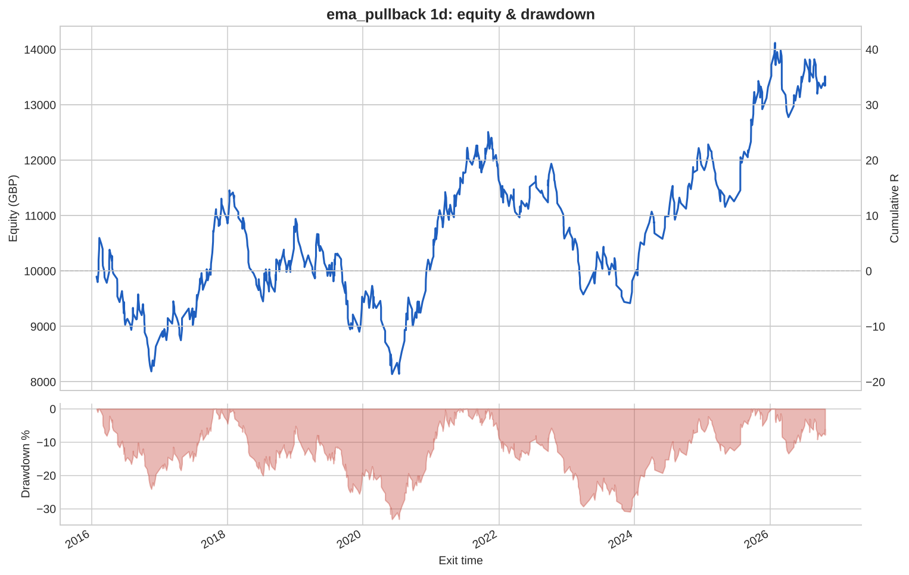
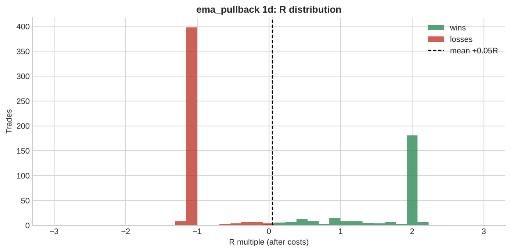

# ema_pullback 1d

**Parameters:** ema_fast=20, ema_mid=50, ema_slow=200, pullback_bars=3, rsi_max=70, sl_atr_buffer=0.5, rr=2.0, max_bars=48

**Costs modelled:** spread per instrument (config), slippage 0.2 pips/pts per side, commission 0.0 GBP/round trip, same-bar SL+TP → pessimistic.  
**Sizing:** 1.0% of GBP 10,000 per trade, fixed.

## Headline

| Metric | Value |
|---|---|
| Trades | 712 |
| Win rate | 38.9% |
| Expectancy (R) | 0.048 |
| Profit factor | 1.080 |
| Payoff ratio | 1.696 |
| Total R | 33.937 |
| Return % | 33.937 |
| Max drawdown (R) | 33.183 |
| Max drawdown % | 33.183 |
| Sharpe (daily) | 0.262 |
| t-stat of mean R | 0.948 |
| Avg bars held | 19.942 |
| Max consecutive losses | 15 |
| Trades / month | 5.497 |
| First trade | 2016-01-05 |
| Last trade | 2026-10-22 |

## By instrument

| instrument | trades | win_rate | expectancy_R | total_R | max_dd_R |
|---|---|---|---|---|---|
| AUDUSD | 30 | 0.267 | -0.200 | -6.002 | 9.448 |
| EURGBP | 24 | 0.333 | -0.142 | -3.414 | 9.141 |
| EURJPY | 22 | 0.545 | 0.128 | 2.821 | 4.776 |
| EURUSD | 29 | 0.483 | 0.354 | 10.254 | 4.383 |
| GBPJPY | 26 | 0.500 | 0.259 | 6.743 | 3.018 |
| GBPUSD | 48 | 0.250 | -0.279 | -13.379 | 14.365 |
| GER40 | 79 | 0.380 | 0.034 | 2.718 | 8.651 |
| JPN225 | 84 | 0.393 | 0.069 | 5.789 | 14.677 |
| NAS100 | 67 | 0.537 | 0.508 | 34.004 | 7.015 |
| SPX500 | 75 | 0.467 | 0.269 | 20.177 | 5.042 |
| UK100 | 75 | 0.333 | -0.115 | -8.652 | 22.003 |
| US30 | 70 | 0.457 | 0.193 | 13.534 | 5.675 |
| USDCAD | 26 | 0.231 | -0.334 | -8.674 | 11.327 |
| USDCHF | 25 | 0.200 | -0.442 | -11.057 | 13.063 |
| USDJPY | 32 | 0.250 | -0.341 | -10.926 | 13.813 |

## By year

| year | trades | win_rate | expectancy_R | total_R | max_dd_R |
|---|---|---|---|---|---|
| 2016 | 72 | 0.319 | -0.189 | -13.628 | 24.103 |
| 2017 | 66 | 0.500 | 0.352 | 23.207 | 7.051 |
| 2018 | 73 | 0.356 | -0.021 | -1.542 | 20.058 |
| 2019 | 80 | 0.325 | -0.158 | -12.675 | 20.378 |
| 2020 | 67 | 0.373 | 0.070 | 4.678 | 15.949 |
| 2021 | 84 | 0.452 | 0.195 | 16.348 | 8.710 |
| 2022 | 56 | 0.304 | -0.188 | -10.540 | 13.521 |
| 2023 | 48 | 0.292 | -0.160 | -7.657 | 13.651 |
| 2024 | 45 | 0.556 | 0.467 | 21.003 | 6.111 |
| 2025 | 51 | 0.431 | 0.275 | 14.006 | 11.284 |
| 2026 | 70 | 0.400 | 0.011 | 0.737 | 12.057 |

## By direction

| direction | trades | win_rate | expectancy_R | total_R | max_dd_R |
|---|---|---|---|---|---|
| long | 482 | 0.444 | 0.195 | 94.208 | 21.344 |
| short | 230 | 0.274 | -0.262 | -60.271 | 67.924 |

## By exit reason

| exit_reason | trades | win_rate | expectancy_R | total_R | max_dd_R |
|---|---|---|---|---|---|
| open_at_end | 5 | 0.600 | 0.296 | 1.480 | 0.553 |
| stop | 408 | 0.000 | -1.018 | -415.4 | 415.4 |
| target | 190 | 1.000 | 2.008 | 381.4 | 0.000 |
| time | 109 | 0.771 | 0.609 | 66.402 | 1.668 |

## By entry hour (UTC)

| entry_hour_utc | trades | win_rate | expectancy_R | total_R | max_dd_R |
|---|---|---|---|---|---|
| 0 | 712 | 0.389 | 0.048 | 33.937 | 33.183 |

## Monte Carlo (1000 runs)

| | p50 | p95 |
|---|---|---|
| Max drawdown, shuffled order (R) | 28.2 | 44.9 |
| Max drawdown, bootstrap (R) | 29.2 | 55.4 |

Bootstrap total R: p5 -23.7, p50 +33.3, p95 +92.4. Probability the edge is actually negative: **16%**.

---

_Backtests use mid/bid prices from free feeds, one position per instrument, no overnight financing, no margin limits. They are research, not a forecast and not advice._