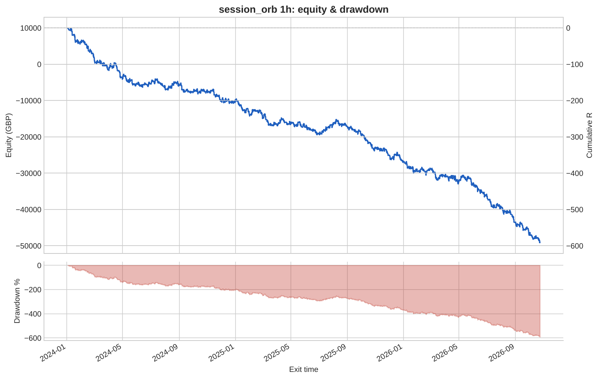
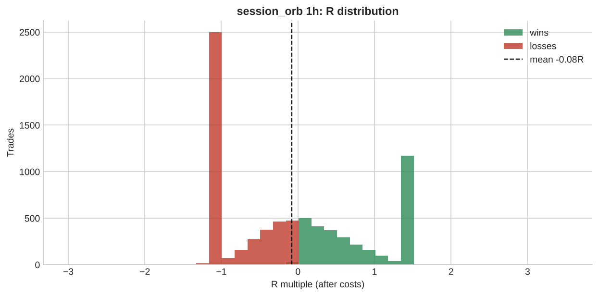

# session_orb 1h

**Parameters:** session=auto, range_bars=1, max_range_atr=1.5, min_bars_left=2, rr=1.5, flat_at_session_end=True

**Costs modelled:** spread per instrument (config), slippage 0.2 pips/pts per side, commission 0.0 GBP/round trip, same-bar SL+TP → pessimistic.  
**Sizing:** 1.0% of GBP 10,000 per trade, fixed.

## Headline

| Metric | Value |
|---|---|
| Trades | 7,638 |
| Win rate | 43.3% |
| Expectancy (R) | -0.077 |
| Profit factor | 0.819 |
| Payoff ratio | 1.074 |
| Total R | -591.6 |
| Return % | -591.6 |
| Max drawdown (R) | 591.6 |
| Max drawdown % | 591.6 |
| Sharpe (daily) | -3.423 |
| t-stat of mean R | -7.514 |
| Avg bars held | 2.955 |
| Max consecutive losses | 21 |
| Trades / month | 226.8 |
| First trade | 2024-01-02 |
| Last trade | 2026-10-23 |

> Return below -100%: with fixed-size risk this strategy would have emptied the account. Read the R figures; the % is just arithmetic.

## By instrument

| instrument | trades | win_rate | expectancy_R | total_R | max_dd_R |
|---|---|---|---|---|---|
| AUDUSD | 733 | 0.413 | -0.094 | -69.153 | 70.607 |
| EURGBP | 623 | 0.366 | -0.279 | -174.0 | 180.9 |
| EURJPY | 592 | 0.421 | -0.088 | -51.918 | 51.918 |
| EURUSD | 651 | 0.404 | -0.124 | -80.774 | 87.575 |
| GBPJPY | 601 | 0.458 | -0.023 | -13.529 | 24.163 |
| GBPUSD | 679 | 0.401 | -0.093 | -63.156 | 68.586 |
| GER40 | 562 | 0.484 | 0.035 | 19.429 | 24.278 |
| JPN225 | 233 | 0.421 | -0.076 | -17.794 | 21.114 |
| NAS100 | 376 | 0.505 | 0.014 | 5.421 | 8.720 |
| SPX500 | 428 | 0.472 | -0.009 | -4.016 | 10.304 |
| UK100 | 272 | 0.460 | -0.088 | -23.842 | 32.202 |
| US30 | 257 | 0.490 | 0.046 | 11.883 | 8.756 |
| USDCAD | 278 | 0.428 | -0.093 | -25.826 | 30.950 |
| USDCHF | 658 | 0.418 | -0.132 | -86.617 | 88.938 |
| USDJPY | 695 | 0.442 | -0.025 | -17.719 | 38.091 |

## By year

| year | trades | win_rate | expectancy_R | total_R | max_dd_R |
|---|---|---|---|---|---|
| 2024 | 2,721 | 0.436 | -0.073 | -198.4 | 208.3 |
| 2025 | 2,684 | 0.435 | -0.063 | -169.0 | 174.9 |
| 2026 | 2,233 | 0.425 | -0.100 | -224.2 | 224.2 |

## By direction

| direction | trades | win_rate | expectancy_R | total_R | max_dd_R |
|---|---|---|---|---|---|
| long | 3,993 | 0.446 | -0.069 | -274.3 | 276.4 |
| short | 3,645 | 0.418 | -0.087 | -317.3 | 318.0 |

## By exit reason

| exit_reason | trades | win_rate | expectancy_R | total_R | max_dd_R |
|---|---|---|---|---|---|
| session_end | 3,950 | 0.539 | 0.081 | 320.5 | 9.225 |
| stop | 2,514 | 0.000 | -1.045 | -2,626.7 | 2,626.7 |
| target | 1,174 | 1.000 | 1.460 | 1,714.6 | 0.000 |

## By entry hour (UTC)

| entry_hour_utc | trades | win_rate | expectancy_R | total_R | max_dd_R |
|---|---|---|---|---|---|
| 2 | 134 | 0.440 | -0.068 | -9.144 | 13.440 |
| 3 | 50 | 0.360 | -0.163 | -8.129 | 8.773 |
| 4 | 49 | 0.429 | -0.011 | -0.521 | 3.327 |
| 9 | 1,553 | 0.458 | -0.042 | -64.460 | 107.2 |
| 10 | 1,571 | 0.403 | -0.094 | -148.4 | 149.3 |
| 11 | 829 | 0.411 | -0.132 | -109.4 | 110.1 |
| 12 | 619 | 0.418 | -0.108 | -66.560 | 66.921 |
| 13 | 709 | 0.425 | -0.107 | -75.814 | 80.721 |
| 14 | 587 | 0.400 | -0.132 | -77.631 | 79.429 |
| 15 | 608 | 0.480 | -0.015 | -9.356 | 30.232 |
| 16 | 416 | 0.510 | 0.002 | 1.019 | 9.419 |
| 17 | 269 | 0.424 | -0.041 | -11.093 | 13.942 |
| 18 | 182 | 0.423 | -0.061 | -11.182 | 15.266 |
| 19 | 62 | 0.484 | -0.015 | -0.913 | 4.433 |

## Monte Carlo (1000 runs)

| | p50 | p95 |
|---|---|---|
| Max drawdown, shuffled order (R) | 599.5 | 613.9 |
| Max drawdown, bootstrap (R) | 597.2 | 733.6 |

Bootstrap total R: p5 -722.6, p50 -587.4, p95 -452.7. Probability the edge is actually negative: **100%**.

---

_Backtests use mid/bid prices from free feeds, one position per instrument, no overnight financing, no margin limits. They are research, not a forecast and not advice._