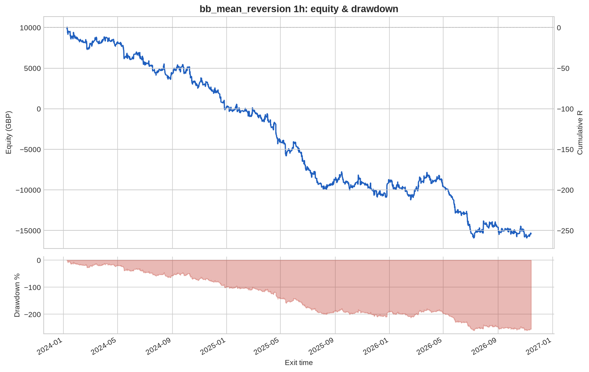
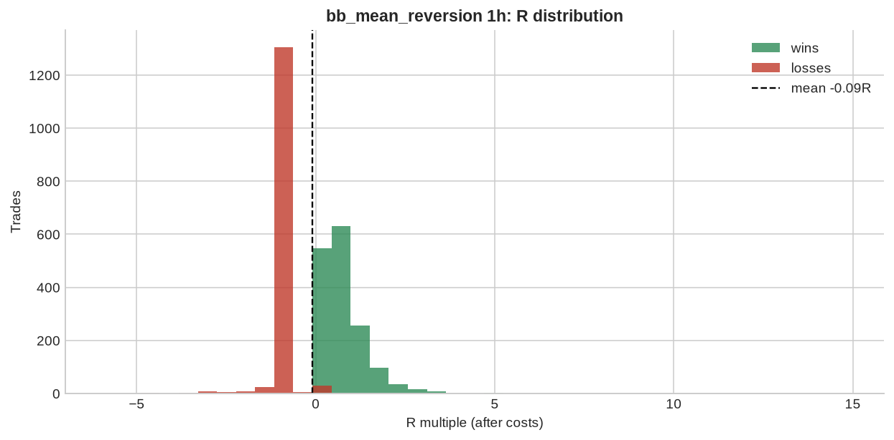

# bb_mean_reversion 1h

**Parameters:** period=20, std=2.0, adx_max=20, sl_atr_buffer=0.5, max_bars=30

**Costs modelled:** spread per instrument (config), slippage 0.2 pips/pts per side, commission 0.0 GBP/round trip, same-bar SL+TP → pessimistic.  
**Sizing:** 1.0% of GBP 10,000 per trade, fixed.

## Headline

| Metric | Value |
|---|---|
| Trades | 2,985 |
| Win rate | 53.6% |
| Expectancy (R) | -0.085 |
| Profit factor | 0.828 |
| Payoff ratio | 0.717 |
| Total R | -254.1 |
| Return % | -254.1 |
| Max drawdown (R) | 259.6 |
| Max drawdown % | 259.6 |
| Sharpe (daily) | -2.239 |
| t-stat of mean R | -4.270 |
| Avg bars held | 4.277 |
| Max consecutive losses | 15 |
| Trades / month | 87.117 |
| First trade | 2024-01-05 |
| Last trade | 2026-11-13 |

> Return below -100%: with fixed-size risk this strategy would have emptied the account. Read the R figures; the % is just arithmetic.

## By instrument

| instrument | trades | win_rate | expectancy_R | total_R | max_dd_R |
|---|---|---|---|---|---|
| AUDUSD | 300 | 0.503 | -0.147 | -44.044 | 48.165 |
| EURGBP | 287 | 0.624 | 0.020 | 5.835 | 13.749 |
| EURJPY | 282 | 0.546 | -0.032 | -9.133 | 25.934 |
| EURUSD | 284 | 0.479 | -0.157 | -44.550 | 47.130 |
| GBPJPY | 313 | 0.569 | -0.046 | -14.434 | 30.566 |
| GBPUSD | 278 | 0.518 | -0.052 | -14.545 | 35.851 |
| GER40 | 90 | 0.389 | -0.302 | -27.207 | 30.963 |
| JPN225 | 36 | 0.361 | -0.265 | -9.554 | 12.005 |
| NAS100 | 51 | 0.451 | -0.334 | -17.055 | 20.180 |
| SPX500 | 48 | 0.458 | -0.295 | -14.147 | 16.928 |
| UK100 | 82 | 0.512 | -0.004 | -0.316 | 13.986 |
| US30 | 73 | 0.425 | -0.153 | -11.203 | 18.922 |
| USDCAD | 273 | 0.612 | -0.043 | -11.652 | 21.404 |
| USDCHF | 322 | 0.584 | -0.059 | -19.029 | 28.316 |
| USDJPY | 266 | 0.511 | -0.087 | -23.105 | 25.747 |

## By year

| year | trades | win_rate | expectancy_R | total_R | max_dd_R |
|---|---|---|---|---|---|
| 2024 | 1,027 | 0.547 | -0.095 | -97.075 | 101.7 |
| 2025 | 1,065 | 0.529 | -0.087 | -92.349 | 114.5 |
| 2026 | 893 | 0.531 | -0.072 | -64.717 | 80.710 |

## By direction

| direction | trades | win_rate | expectancy_R | total_R | max_dd_R |
|---|---|---|---|---|---|
| long | 1,332 | 0.552 | -0.070 | -93.640 | 104.0 |
| short | 1,653 | 0.523 | -0.097 | -160.5 | 182.4 |

## By exit reason

| exit_reason | trades | win_rate | expectancy_R | total_R | max_dd_R |
|---|---|---|---|---|---|
| open_at_end | 2 | 0.000 | -0.476 | -0.953 | 0.953 |
| stop | 1,350 | 0.000 | -1.090 | -1,471.4 | 1,471.4 |
| target | 1,618 | 0.982 | 0.751 | 1,215.1 | 0.068 |
| time | 15 | 0.667 | 0.212 | 3.180 | 0.688 |

## By entry hour (UTC)

| entry_hour_utc | trades | win_rate | expectancy_R | total_R | max_dd_R |
|---|---|---|---|---|---|
| 0 | 26 | 0.654 | -0.006 | -0.160 | 3.145 |
| 1 | 32 | 0.594 | -0.066 | -2.116 | 4.522 |
| 2 | 75 | 0.560 | -0.044 | -3.333 | 13.645 |
| 3 | 109 | 0.495 | -0.119 | -13.023 | 21.039 |
| 4 | 84 | 0.452 | -0.171 | -14.342 | 18.214 |
| 5 | 58 | 0.362 | -0.262 | -15.218 | 23.798 |
| 6 | 71 | 0.479 | -0.035 | -2.455 | 14.097 |
| 7 | 91 | 0.505 | -0.185 | -16.825 | 20.636 |
| 8 | 107 | 0.598 | -0.084 | -8.963 | 20.394 |
| 9 | 173 | 0.618 | -0.041 | -7.155 | 13.029 |
| 10 | 206 | 0.544 | -0.107 | -21.973 | 29.818 |
| 11 | 211 | 0.521 | -0.128 | -26.958 | 38.312 |
| 12 | 185 | 0.519 | -0.049 | -9.137 | 24.035 |
| 13 | 159 | 0.541 | -0.130 | -20.609 | 25.988 |
| 14 | 201 | 0.582 | -0.113 | -22.620 | 32.379 |
| 15 | 229 | 0.581 | -0.055 | -12.555 | 16.433 |
| 16 | 225 | 0.547 | -0.135 | -30.289 | 38.904 |
| 17 | 234 | 0.538 | -0.047 | -11.091 | 25.631 |
| 18 | 159 | 0.491 | -0.180 | -28.644 | 41.162 |
| 19 | 118 | 0.492 | -0.072 | -8.480 | 12.757 |
| 20 | 81 | 0.605 | 0.188 | 15.205 | 6.528 |
| 21 | 78 | 0.449 | 0.028 | 2.184 | 11.615 |
| 22 | 47 | 0.404 | 0.075 | 3.524 | 9.836 |
| 23 | 26 | 0.577 | 0.034 | 0.889 | 4.979 |

## Monte Carlo (1000 runs)

| | p50 | p95 |
|---|---|---|
| Max drawdown, shuffled order (R) | 264.4 | 283.7 |
| Max drawdown, bootstrap (R) | 266.7 | 357.3 |

Bootstrap total R: p5 -347.0, p50 -253.4, p95 -155.7. Probability the edge is actually negative: **100%**.

---

_Backtests use mid/bid prices from free feeds, one position per instrument, no overnight financing, no margin limits. They are research, not a forecast and not advice._