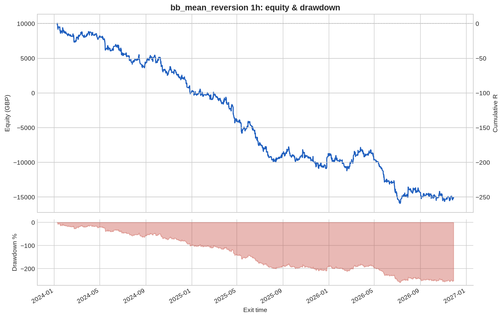
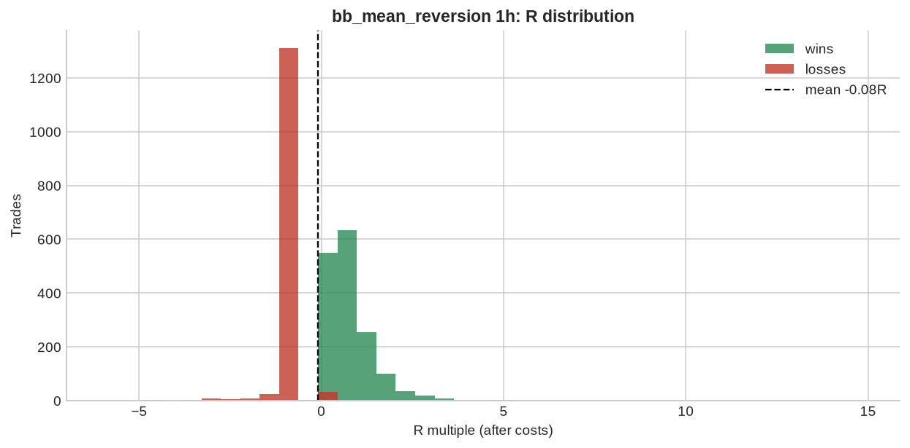

# bb_mean_reversion 1h

**Parameters:** period=20, std=2.0, adx_max=20, sl_atr_buffer=0.5, max_bars=30

**Costs modelled:** spread per instrument (config), slippage 0.2 pips/pts per side, commission 0.0 GBP/round trip, same-bar SL+TP → pessimistic.  
**Sizing:** 1.0% of GBP 10,000 per trade, fixed.

## Headline

| Metric | Value |
|---|---|
| Trades | 3,023 |
| Win rate | 53.6% |
| Expectancy (R) | -0.083 |
| Profit factor | 0.831 |
| Payoff ratio | 0.719 |
| Total R | -251.3 |
| Return % | -251.3 |
| Max drawdown (R) | 259.6 |
| Max drawdown % | 259.6 |
| Sharpe (daily) | -2.182 |
| t-stat of mean R | -4.192 |
| Avg bars held | 4.260 |
| Max consecutive losses | 15 |
| Trades / month | 87.058 |
| First trade | 2024-01-05 |
| Last trade | 2026-11-27 |

> Return below -100%: with fixed-size risk this strategy would have emptied the account. Read the R figures; the % is just arithmetic.

## By instrument

| instrument | trades | win_rate | expectancy_R | total_R | max_dd_R |
|---|---|---|---|---|---|
| AUDUSD | 302 | 0.503 | -0.149 | -44.991 | 48.905 |
| EURGBP | 291 | 0.619 | 0.012 | 3.551 | 13.790 |
| EURJPY | 284 | 0.549 | -0.024 | -6.898 | 25.934 |
| EURUSD | 286 | 0.483 | -0.149 | -42.531 | 47.115 |
| GBPJPY | 315 | 0.568 | -0.046 | -14.580 | 30.566 |
| GBPUSD | 281 | 0.523 | -0.036 | -10.208 | 35.851 |
| GER40 | 91 | 0.385 | -0.310 | -28.213 | 31.943 |
| JPN225 | 37 | 0.351 | -0.313 | -11.579 | 13.061 |
| NAS100 | 51 | 0.451 | -0.334 | -17.056 | 20.180 |
| SPX500 | 48 | 0.458 | -0.295 | -14.147 | 16.928 |
| UK100 | 82 | 0.512 | -0.003 | -0.269 | 13.986 |
| US30 | 75 | 0.413 | -0.165 | -12.387 | 18.922 |
| USDCAD | 277 | 0.610 | -0.045 | -12.370 | 21.414 |
| USDCHF | 329 | 0.584 | -0.062 | -20.526 | 28.221 |
| USDJPY | 274 | 0.518 | -0.070 | -19.102 | 25.749 |

## By year

| year | trades | win_rate | expectancy_R | total_R | max_dd_R |
|---|---|---|---|---|---|
| 2024 | 1,027 | 0.547 | -0.095 | -97.075 | 101.7 |
| 2025 | 1,065 | 0.529 | -0.087 | -92.349 | 114.5 |
| 2026 | 931 | 0.533 | -0.066 | -61.881 | 80.754 |

## By direction

| direction | trades | win_rate | expectancy_R | total_R | max_dd_R |
|---|---|---|---|---|---|
| long | 1,346 | 0.551 | -0.071 | -95.745 | 103.5 |
| short | 1,677 | 0.524 | -0.093 | -155.6 | 182.4 |

## By exit reason

| exit_reason | trades | win_rate | expectancy_R | total_R | max_dd_R |
|---|---|---|---|---|---|
| open_at_end | 3 | 0.000 | -0.302 | -0.906 | 0.906 |
| stop | 1,365 | 0.000 | -1.090 | -1,488.2 | 1,488.2 |
| target | 1,640 | 0.982 | 0.753 | 1,234.6 | 0.068 |
| time | 15 | 0.667 | 0.212 | 3.180 | 0.688 |

## By entry hour (UTC)

| entry_hour_utc | trades | win_rate | expectancy_R | total_R | max_dd_R |
|---|---|---|---|---|---|
| 0 | 26 | 0.654 | -0.006 | -0.159 | 3.145 |
| 1 | 33 | 0.606 | -0.010 | -0.325 | 4.522 |
| 2 | 75 | 0.560 | -0.044 | -3.318 | 13.645 |
| 3 | 109 | 0.495 | -0.119 | -13.023 | 21.039 |
| 4 | 85 | 0.459 | -0.165 | -13.989 | 18.216 |
| 5 | 59 | 0.356 | -0.292 | -17.222 | 23.777 |
| 6 | 72 | 0.472 | -0.048 | -3.453 | 14.365 |
| 7 | 93 | 0.516 | -0.179 | -16.668 | 20.631 |
| 8 | 109 | 0.596 | -0.086 | -9.422 | 20.395 |
| 9 | 174 | 0.621 | -0.039 | -6.811 | 12.685 |
| 10 | 207 | 0.546 | -0.103 | -21.390 | 29.824 |
| 11 | 216 | 0.523 | -0.131 | -28.396 | 38.536 |
| 12 | 192 | 0.521 | -0.031 | -5.903 | 24.035 |
| 13 | 160 | 0.538 | -0.135 | -21.657 | 25.989 |
| 14 | 204 | 0.578 | -0.117 | -23.862 | 32.426 |
| 15 | 230 | 0.583 | -0.053 | -12.304 | 16.430 |
| 16 | 227 | 0.546 | -0.137 | -31.193 | 38.906 |
| 17 | 237 | 0.532 | -0.054 | -12.878 | 25.631 |
| 18 | 159 | 0.491 | -0.176 | -28.049 | 41.162 |
| 19 | 119 | 0.496 | -0.057 | -6.809 | 12.757 |
| 20 | 82 | 0.610 | 0.193 | 15.852 | 6.528 |
| 21 | 81 | 0.457 | 0.040 | 3.211 | 11.617 |
| 22 | 48 | 0.417 | 0.116 | 5.574 | 9.836 |
| 23 | 26 | 0.577 | 0.034 | 0.889 | 4.979 |

## Monte Carlo (1000 runs)

| | p50 | p95 |
|---|---|---|
| Max drawdown, shuffled order (R) | 262.2 | 285.2 |
| Max drawdown, bootstrap (R) | 267.6 | 358.0 |

Bootstrap total R: p5 -350.1, p50 -253.6, p95 -156.5. Probability the edge is actually negative: **100%**.

---

_Backtests use mid/bid prices from free feeds, one position per instrument, no overnight financing, no margin limits. They are research, not a forecast and not advice._