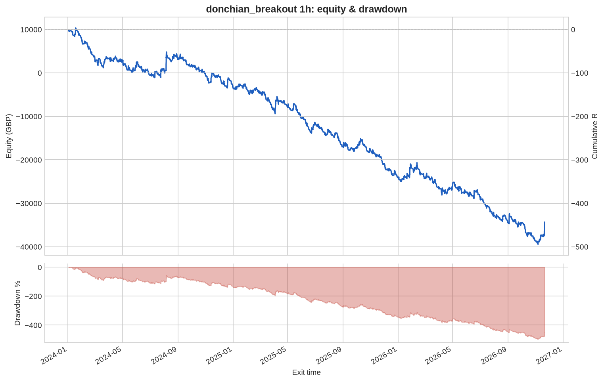
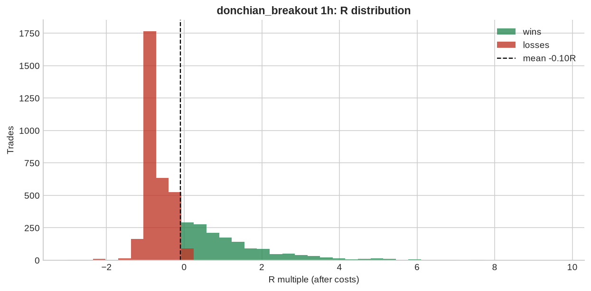

# donchian_breakout 1h

**Parameters:** lookback=20, adx_min=20, sl_atr=2.0, trail_atr=2.0, rr=None, max_bars=200

**Costs modelled:** spread per instrument (config), slippage 0.2 pips/pts per side, commission 0.0 GBP/round trip, same-bar SL+TP → pessimistic.  
**Sizing:** 1.0% of GBP 10,000 per trade, fixed.

## Headline

| Metric | Value |
|---|---|
| Trades | 4,761 |
| Win rate | 32.4% |
| Expectancy (R) | -0.097 |
| Profit factor | 0.812 |
| Payoff ratio | 1.691 |
| Total R | -460.4 |
| Return % | -460.4 |
| Max drawdown (R) | 493.0 |
| Max drawdown % | 493.0 |
| Sharpe (daily) | -2.246 |
| t-stat of mean R | -5.362 |
| Avg bars held | 13.702 |
| Max consecutive losses | 29 |
| Trades / month | 136.7 |
| First trade | 2024-01-02 |
| Last trade | 2026-11-27 |

> Return below -100%: with fixed-size risk this strategy would have emptied the account. Read the R figures; the % is just arithmetic.

## By instrument

| instrument | trades | win_rate | expectancy_R | total_R | max_dd_R |
|---|---|---|---|---|---|
| AUDUSD | 439 | 0.301 | -0.138 | -60.736 | 81.695 |
| EURGBP | 396 | 0.283 | -0.298 | -118.1 | 118.3 |
| EURJPY | 407 | 0.329 | -0.113 | -46.162 | 48.156 |
| EURUSD | 453 | 0.336 | -0.102 | -46.185 | 53.139 |
| GBPJPY | 417 | 0.331 | -0.107 | -44.524 | 46.460 |
| GBPUSD | 477 | 0.321 | -0.090 | -42.799 | 47.431 |
| GER40 | 181 | 0.359 | 0.022 | 3.986 | 23.215 |
| JPN225 | 159 | 0.352 | 0.161 | 25.529 | 8.544 |
| NAS100 | 155 | 0.335 | 0.018 | 2.767 | 15.489 |
| SPX500 | 155 | 0.342 | -0.190 | -29.507 | 31.637 |
| UK100 | 183 | 0.322 | 0.049 | 8.990 | 19.944 |
| US30 | 153 | 0.340 | -0.036 | -5.451 | 26.789 |
| USDCAD | 333 | 0.342 | -0.083 | -27.528 | 36.799 |
| USDCHF | 416 | 0.305 | -0.162 | -67.270 | 72.504 |
| USDJPY | 437 | 0.332 | -0.031 | -13.478 | 23.574 |

## By year

| year | trades | win_rate | expectancy_R | total_R | max_dd_R |
|---|---|---|---|---|---|
| 2024 | 1,556 | 0.319 | -0.087 | -135.0 | 138.3 |
| 2025 | 1,697 | 0.329 | -0.121 | -205.5 | 215.9 |
| 2026 | 1,508 | 0.324 | -0.080 | -119.9 | 183.2 |

## By direction

| direction | trades | win_rate | expectancy_R | total_R | max_dd_R |
|---|---|---|---|---|---|
| long | 2,432 | 0.336 | -0.069 | -168.6 | 180.9 |
| short | 2,329 | 0.313 | -0.125 | -291.8 | 321.2 |

## By exit reason

| exit_reason | trades | win_rate | expectancy_R | total_R | max_dd_R |
|---|---|---|---|---|---|
| open_at_end | 7 | 0.571 | 0.190 | 1.328 | 0.996 |
| stop | 1,174 | 0.000 | -1.045 | -1,226.4 | 1,226.4 |
| time | 5 | 1.000 | 3.124 | 15.622 | 0.000 |
| trail_stop | 3,575 | 0.429 | 0.210 | 749.1 | 23.101 |

## By entry hour (UTC)

| entry_hour_utc | trades | win_rate | expectancy_R | total_R | max_dd_R |
|---|---|---|---|---|---|
| 0 | 109 | 0.339 | -0.112 | -12.208 | 17.426 |
| 1 | 263 | 0.399 | 0.074 | 19.523 | 15.123 |
| 2 | 128 | 0.352 | 0.067 | 8.585 | 14.843 |
| 3 | 99 | 0.253 | -0.104 | -10.317 | 19.232 |
| 4 | 105 | 0.343 | -0.059 | -6.159 | 21.863 |
| 5 | 104 | 0.202 | -0.460 | -47.801 | 50.477 |
| 6 | 110 | 0.345 | 0.026 | 2.821 | 12.930 |
| 7 | 160 | 0.338 | -0.088 | -14.070 | 25.355 |
| 8 | 319 | 0.339 | -0.034 | -10.851 | 34.695 |
| 9 | 271 | 0.332 | -0.076 | -20.686 | 42.693 |
| 10 | 215 | 0.298 | -0.195 | -42.011 | 44.176 |
| 11 | 185 | 0.324 | -0.147 | -27.115 | 39.948 |
| 12 | 211 | 0.256 | -0.235 | -49.495 | 64.261 |
| 13 | 406 | 0.303 | -0.147 | -59.860 | 70.462 |
| 14 | 504 | 0.329 | -0.034 | -16.935 | 48.653 |
| 15 | 476 | 0.366 | -0.066 | -31.244 | 49.853 |
| 16 | 271 | 0.347 | -0.068 | -18.418 | 27.091 |
| 17 | 197 | 0.360 | 0.062 | 12.116 | 24.601 |
| 18 | 165 | 0.279 | -0.153 | -25.222 | 40.977 |
| 19 | 215 | 0.237 | -0.310 | -66.660 | 66.660 |
| 20 | 103 | 0.340 | -0.090 | -9.273 | 12.636 |
| 21 | 69 | 0.304 | -0.292 | -20.130 | 20.130 |
| 22 | 42 | 0.333 | -0.185 | -7.763 | 10.454 |
| 23 | 34 | 0.353 | -0.213 | -7.254 | 8.106 |

## Monte Carlo (1000 runs)

| | p50 | p95 |
|---|---|---|
| Max drawdown, shuffled order (R) | 472.5 | 496.3 |
| Max drawdown, bootstrap (R) | 471.3 | 620.5 |

Bootstrap total R: p5 -608.1, p50 -461.2, p95 -319.7. Probability the edge is actually negative: **100%**.

---

_Backtests use mid/bid prices from free feeds, one position per instrument, no overnight financing, no margin limits. They are research, not a forecast and not advice._