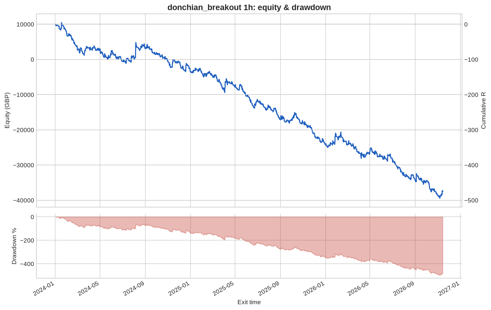
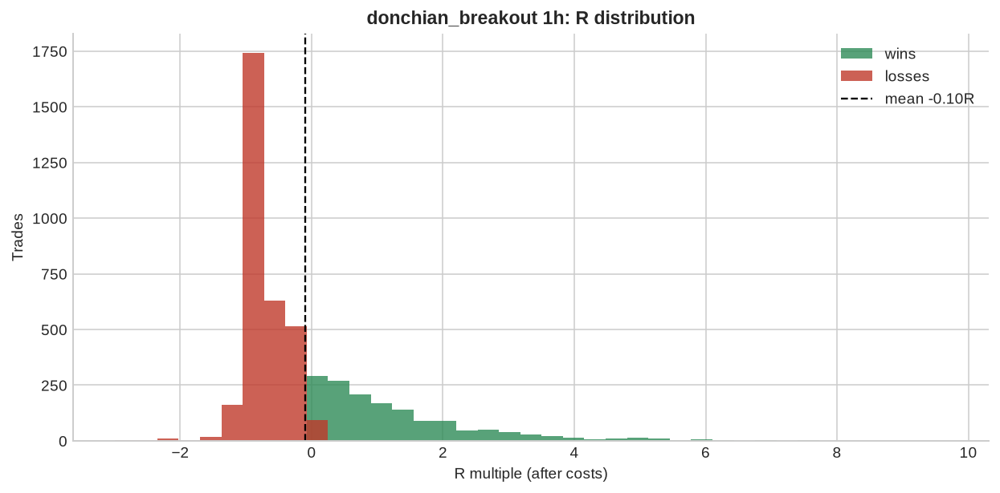

# donchian_breakout 1h

**Parameters:** lookback=20, adx_min=20, sl_atr=2.0, trail_atr=2.0, rr=None, max_bars=200

**Costs modelled:** spread per instrument (config), slippage 0.2 pips/pts per side, commission 0.0 GBP/round trip, same-bar SL+TP → pessimistic.  
**Sizing:** 1.0% of GBP 10,000 per trade, fixed.

## Headline

| Metric | Value |
|---|---|
| Trades | 4,697 |
| Win rate | 32.3% |
| Expectancy (R) | -0.101 |
| Profit factor | 0.804 |
| Payoff ratio | 1.683 |
| Total R | -472.9 |
| Return % | -472.9 |
| Max drawdown (R) | 499.0 |
| Max drawdown % | 499.0 |
| Sharpe (daily) | -2.357 |
| t-stat of mean R | -5.569 |
| Avg bars held | 13.659 |
| Max consecutive losses | 29 |
| Trades / month | 136.7 |
| First trade | 2024-01-02 |
| Last trade | 2026-11-13 |

> Return below -100%: with fixed-size risk this strategy would have emptied the account. Read the R figures; the % is just arithmetic.

## By instrument

| instrument | trades | win_rate | expectancy_R | total_R | max_dd_R |
|---|---|---|---|---|---|
| AUDUSD | 437 | 0.297 | -0.151 | -66.169 | 82.545 |
| EURGBP | 392 | 0.283 | -0.300 | -117.5 | 117.5 |
| EURJPY | 398 | 0.332 | -0.108 | -42.820 | 46.504 |
| EURUSD | 449 | 0.336 | -0.101 | -45.238 | 54.076 |
| GBPJPY | 409 | 0.333 | -0.104 | -42.514 | 45.624 |
| GBPUSD | 467 | 0.321 | -0.084 | -39.131 | 46.522 |
| GER40 | 176 | 0.352 | -0.002 | -0.281 | 23.217 |
| JPN225 | 157 | 0.350 | 0.168 | 26.324 | 7.746 |
| NAS100 | 152 | 0.342 | 0.031 | 4.667 | 15.009 |
| SPX500 | 154 | 0.331 | -0.211 | -32.551 | 33.834 |
| UK100 | 180 | 0.322 | 0.015 | 2.751 | 19.719 |
| US30 | 150 | 0.333 | -0.079 | -11.908 | 26.790 |
| USDCAD | 328 | 0.341 | -0.079 | -25.821 | 38.895 |
| USDCHF | 414 | 0.304 | -0.164 | -67.820 | 72.741 |
| USDJPY | 434 | 0.329 | -0.034 | -14.913 | 23.612 |

## By year

| year | trades | win_rate | expectancy_R | total_R | max_dd_R |
|---|---|---|---|---|---|
| 2024 | 1,556 | 0.319 | -0.087 | -135.0 | 139.4 |
| 2025 | 1,697 | 0.329 | -0.121 | -205.5 | 216.9 |
| 2026 | 1,444 | 0.321 | -0.092 | -132.4 | 188.1 |

## By direction

| direction | trades | win_rate | expectancy_R | total_R | max_dd_R |
|---|---|---|---|---|---|
| long | 2,410 | 0.336 | -0.068 | -164.1 | 183.2 |
| short | 2,287 | 0.310 | -0.135 | -308.8 | 322.4 |

## By exit reason

| exit_reason | trades | win_rate | expectancy_R | total_R | max_dd_R |
|---|---|---|---|---|---|
| open_at_end | 8 | 0.625 | 0.173 | 1.386 | 0.726 |
| stop | 1,160 | 0.000 | -1.045 | -1,212.1 | 1,212.1 |
| time | 5 | 1.000 | 3.124 | 15.622 | 0.000 |
| trail_stop | 3,524 | 0.428 | 0.205 | 722.1 | 22.959 |

## By entry hour (UTC)

| entry_hour_utc | trades | win_rate | expectancy_R | total_R | max_dd_R |
|---|---|---|---|---|---|
| 0 | 108 | 0.343 | -0.103 | -11.176 | 17.426 |
| 1 | 261 | 0.395 | 0.067 | 17.366 | 15.126 |
| 2 | 127 | 0.346 | 0.068 | 8.589 | 14.856 |
| 3 | 98 | 0.255 | -0.095 | -9.288 | 19.232 |
| 4 | 105 | 0.343 | -0.059 | -6.152 | 21.864 |
| 5 | 103 | 0.204 | -0.454 | -46.795 | 49.471 |
| 6 | 108 | 0.333 | 0.018 | 1.987 | 12.930 |
| 7 | 159 | 0.340 | -0.084 | -13.296 | 25.355 |
| 8 | 315 | 0.340 | -0.032 | -10.104 | 34.709 |
| 9 | 263 | 0.338 | -0.082 | -21.436 | 42.144 |
| 10 | 213 | 0.305 | -0.191 | -40.591 | 44.131 |
| 11 | 185 | 0.324 | -0.146 | -26.932 | 39.948 |
| 12 | 209 | 0.254 | -0.236 | -49.330 | 64.261 |
| 13 | 400 | 0.305 | -0.149 | -59.529 | 70.462 |
| 14 | 500 | 0.330 | -0.037 | -18.640 | 49.609 |
| 15 | 471 | 0.361 | -0.073 | -34.236 | 52.791 |
| 16 | 265 | 0.340 | -0.093 | -24.685 | 27.199 |
| 17 | 193 | 0.352 | 0.027 | 5.251 | 24.601 |
| 18 | 159 | 0.264 | -0.163 | -25.842 | 39.961 |
| 19 | 213 | 0.239 | -0.308 | -65.498 | 65.498 |
| 20 | 100 | 0.350 | -0.067 | -6.746 | 12.636 |
| 21 | 69 | 0.304 | -0.291 | -20.110 | 20.110 |
| 22 | 39 | 0.333 | -0.218 | -8.492 | 10.454 |
| 23 | 34 | 0.353 | -0.213 | -7.254 | 8.106 |

## Monte Carlo (1000 runs)

| | p50 | p95 |
|---|---|---|
| Max drawdown, shuffled order (R) | 484.2 | 509.9 |
| Max drawdown, bootstrap (R) | 490.6 | 624.1 |

Bootstrap total R: p5 -614.3, p50 -478.1, p95 -335.7. Probability the edge is actually negative: **100%**.

---

_Backtests use mid/bid prices from free feeds, one position per instrument, no overnight financing, no margin limits. They are research, not a forecast and not advice._