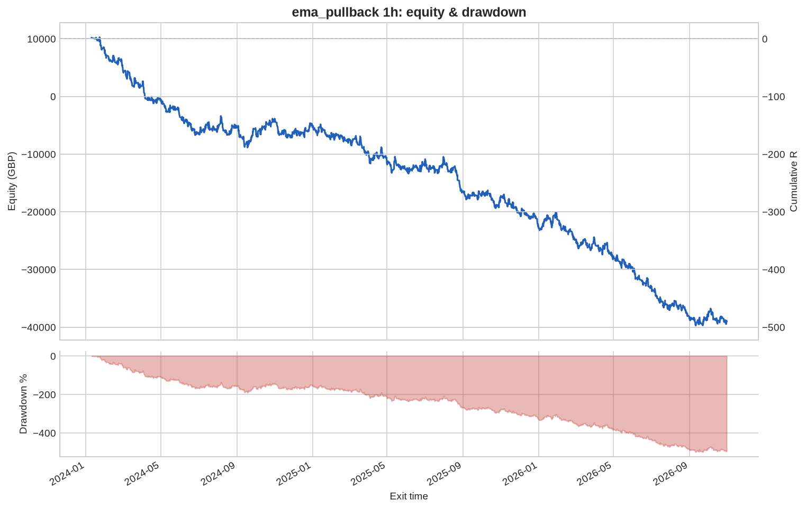
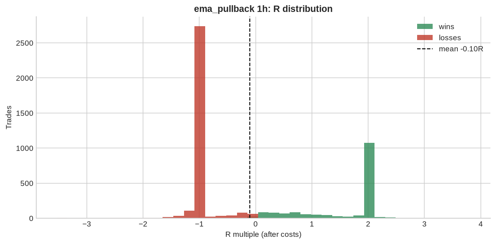

# ema_pullback 1h

**Parameters:** ema_fast=20, ema_mid=50, ema_slow=200, pullback_bars=3, rsi_max=70, sl_atr_buffer=0.5, rr=2.0, max_bars=48

**Costs modelled:** spread per instrument (config), slippage 0.2 pips/pts per side, commission 0.0 GBP/round trip, same-bar SL+TP → pessimistic.  
**Sizing:** 1.0% of GBP 10,000 per trade, fixed.

## Headline

| Metric | Value |
|---|---|
| Trades | 4,842 |
| Win rate | 34.8% |
| Expectancy (R) | -0.101 |
| Profit factor | 0.844 |
| Payoff ratio | 1.581 |
| Total R | -490.5 |
| Return % | -490.5 |
| Max drawdown (R) | 500.0 |
| Max drawdown % | 500.0 |
| Sharpe (daily) | -2.461 |
| t-stat of mean R | -5.423 |
| Avg bars held | 20.205 |
| Max consecutive losses | 27 |
| Trades / month | 143.2 |
| First trade | 2024-01-05 |
| Last trade | 2026-10-30 |

> Return below -100%: with fixed-size risk this strategy would have emptied the account. Read the R figures; the % is just arithmetic.

## By instrument

| instrument | trades | win_rate | expectancy_R | total_R | max_dd_R |
|---|---|---|---|---|---|
| AUDUSD | 477 | 0.342 | -0.112 | -53.436 | 57.774 |
| EURGBP | 443 | 0.302 | -0.236 | -104.5 | 119.1 |
| EURJPY | 441 | 0.349 | -0.103 | -45.221 | 46.849 |
| EURUSD | 467 | 0.364 | -0.037 | -17.491 | 32.706 |
| GBPJPY | 448 | 0.333 | -0.122 | -54.490 | 65.550 |
| GBPUSD | 463 | 0.337 | -0.144 | -66.846 | 68.902 |
| GER40 | 161 | 0.348 | -0.069 | -11.104 | 21.563 |
| JPN225 | 110 | 0.427 | 0.147 | 16.206 | 8.131 |
| NAS100 | 122 | 0.377 | -0.054 | -6.637 | 12.906 |
| SPX500 | 130 | 0.385 | -0.014 | -1.846 | 14.393 |
| UK100 | 184 | 0.353 | -0.008 | -1.517 | 20.425 |
| US30 | 128 | 0.336 | -0.121 | -15.541 | 18.616 |
| USDCAD | 396 | 0.399 | -0.004 | -1.483 | 44.377 |
| USDCHF | 441 | 0.317 | -0.205 | -90.324 | 95.481 |
| USDJPY | 431 | 0.357 | -0.084 | -36.247 | 41.561 |

## By year

| year | trades | win_rate | expectancy_R | total_R | max_dd_R |
|---|---|---|---|---|---|
| 2024 | 1,675 | 0.355 | -0.091 | -151.7 | 191.3 |
| 2025 | 1,715 | 0.341 | -0.103 | -177.3 | 180.6 |
| 2026 | 1,452 | 0.349 | -0.111 | -161.5 | 196.3 |

## By direction

| direction | trades | win_rate | expectancy_R | total_R | max_dd_R |
|---|---|---|---|---|---|
| long | 2,801 | 0.365 | -0.066 | -184.7 | 191.7 |
| short | 2,041 | 0.325 | -0.150 | -305.7 | 329.2 |

## By exit reason

| exit_reason | trades | win_rate | expectancy_R | total_R | max_dd_R |
|---|---|---|---|---|---|
| open_at_end | 11 | 0.273 | -0.079 | -0.872 | 1.515 |
| stop | 2,917 | 0.000 | -1.050 | -3,061.5 | 3,061.5 |
| target | 1,136 | 1.000 | 1.987 | 2,257.7 | 0.000 |
| time | 778 | 0.702 | 0.404 | 314.2 | 2.335 |

## By entry hour (UTC)

| entry_hour_utc | trades | win_rate | expectancy_R | total_R | max_dd_R |
|---|---|---|---|---|---|
| 0 | 141 | 0.348 | -0.048 | -6.796 | 17.397 |
| 1 | 268 | 0.414 | 0.079 | 21.290 | 14.469 |
| 2 | 161 | 0.342 | -0.099 | -16.012 | 32.832 |
| 3 | 138 | 0.304 | -0.221 | -30.535 | 33.128 |
| 4 | 144 | 0.299 | -0.184 | -26.537 | 34.222 |
| 5 | 127 | 0.394 | 0.092 | 11.729 | 10.946 |
| 6 | 151 | 0.318 | -0.132 | -19.881 | 30.246 |
| 7 | 211 | 0.355 | -0.007 | -1.430 | 20.617 |
| 8 | 349 | 0.312 | -0.182 | -63.667 | 64.594 |
| 9 | 266 | 0.286 | -0.270 | -71.869 | 76.920 |
| 10 | 213 | 0.385 | -0.002 | -0.496 | 18.489 |
| 11 | 182 | 0.313 | -0.168 | -30.538 | 42.003 |
| 12 | 227 | 0.352 | -0.097 | -21.925 | 22.585 |
| 13 | 310 | 0.423 | 0.023 | 7.162 | 27.115 |
| 14 | 390 | 0.351 | -0.123 | -48.000 | 57.210 |
| 15 | 405 | 0.373 | -0.082 | -33.152 | 49.378 |
| 16 | 282 | 0.397 | -0.023 | -6.513 | 33.624 |
| 17 | 187 | 0.364 | -0.097 | -18.123 | 26.396 |
| 18 | 182 | 0.346 | -0.054 | -9.785 | 34.595 |
| 19 | 179 | 0.313 | -0.165 | -29.536 | 40.349 |
| 20 | 133 | 0.293 | -0.261 | -34.673 | 50.425 |
| 21 | 95 | 0.232 | -0.414 | -39.324 | 41.252 |
| 22 | 47 | 0.298 | -0.192 | -9.041 | 12.026 |
| 23 | 54 | 0.278 | -0.237 | -12.808 | 17.618 |

## Monte Carlo (1000 runs)

| | p50 | p95 |
|---|---|---|
| Max drawdown, shuffled order (R) | 503.2 | 528.6 |
| Max drawdown, bootstrap (R) | 506.2 | 655.3 |

Bootstrap total R: p5 -645.5, p50 -490.6, p95 -345.1. Probability the edge is actually negative: **100%**.

---

_Backtests use mid/bid prices from free feeds, one position per instrument, no overnight financing, no margin limits. They are research, not a forecast and not advice._