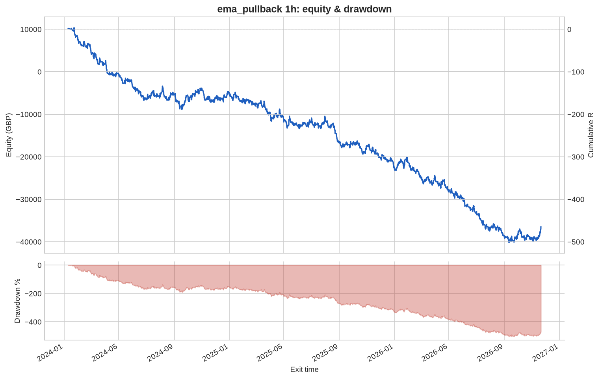
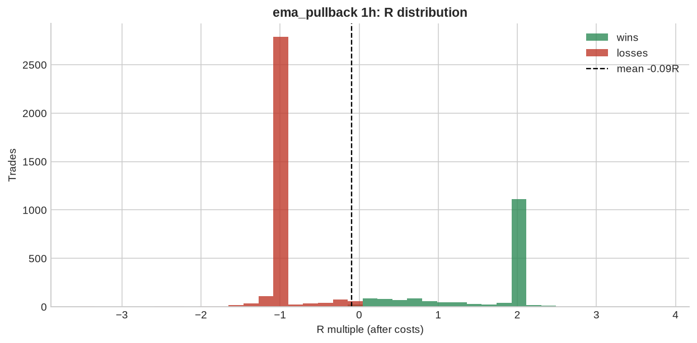

# ema_pullback 1h

**Parameters:** ema_fast=20, ema_mid=50, ema_slow=200, pullback_bars=3, rsi_max=70, sl_atr_buffer=0.5, rr=2.0, max_bars=48

**Costs modelled:** spread per instrument (config), slippage 0.2 pips/pts per side, commission 0.0 GBP/round trip, same-bar SL+TP → pessimistic.  
**Sizing:** 1.0% of GBP 10,000 per trade, fixed.

## Headline

| Metric | Value |
|---|---|
| Trades | 4,945 |
| Win rate | 35.1% |
| Expectancy (R) | -0.094 |
| Profit factor | 0.855 |
| Payoff ratio | 1.580 |
| Total R | -464.3 |
| Return % | -464.3 |
| Max drawdown (R) | 505.2 |
| Max drawdown % | 505.2 |
| Sharpe (daily) | -2.259 |
| t-stat of mean R | -5.064 |
| Avg bars held | 20.183 |
| Max consecutive losses | 26 |
| Trades / month | 143.4 |
| First trade | 2024-01-05 |
| Last trade | 2026-11-20 |

> Return below -100%: with fixed-size risk this strategy would have emptied the account. Read the R figures; the % is just arithmetic.

## By instrument

| instrument | trades | win_rate | expectancy_R | total_R | max_dd_R |
|---|---|---|---|---|---|
| AUDUSD | 487 | 0.351 | -0.085 | -41.593 | 57.776 |
| EURGBP | 453 | 0.307 | -0.229 | -103.8 | 119.1 |
| EURJPY | 450 | 0.349 | -0.098 | -44.177 | 50.280 |
| EURUSD | 477 | 0.365 | -0.041 | -19.691 | 34.314 |
| GBPJPY | 457 | 0.337 | -0.112 | -51.133 | 67.080 |
| GBPUSD | 472 | 0.341 | -0.133 | -62.927 | 69.343 |
| GER40 | 166 | 0.349 | -0.064 | -10.605 | 21.563 |
| JPN225 | 115 | 0.435 | 0.184 | 21.204 | 8.131 |
| NAS100 | 125 | 0.384 | -0.032 | -4.039 | 12.900 |
| SPX500 | 133 | 0.391 | -0.005 | -0.708 | 14.393 |
| UK100 | 187 | 0.358 | 0.007 | 1.245 | 20.425 |
| US30 | 130 | 0.331 | -0.138 | -17.960 | 20.687 |
| USDCAD | 404 | 0.401 | -0.000 | -0.127 | 44.377 |
| USDCHF | 448 | 0.324 | -0.194 | -87.069 | 95.486 |
| USDJPY | 441 | 0.351 | -0.097 | -42.990 | 48.304 |

## By year

| year | trades | win_rate | expectancy_R | total_R | max_dd_R |
|---|---|---|---|---|---|
| 2024 | 1,675 | 0.355 | -0.091 | -151.7 | 192.2 |
| 2025 | 1,715 | 0.341 | -0.103 | -177.3 | 180.6 |
| 2026 | 1,555 | 0.359 | -0.087 | -135.4 | 200.6 |

## By direction

| direction | trades | win_rate | expectancy_R | total_R | max_dd_R |
|---|---|---|---|---|---|
| long | 2,851 | 0.365 | -0.068 | -192.6 | 201.8 |
| short | 2,094 | 0.332 | -0.130 | -271.7 | 329.2 |

## By exit reason

| exit_reason | trades | win_rate | expectancy_R | total_R | max_dd_R |
|---|---|---|---|---|---|
| open_at_end | 4 | 1.000 | 0.518 | 2.074 | 0.000 |
| stop | 2,973 | 0.000 | -1.050 | -3,121.0 | 3,121.0 |
| target | 1,174 | 1.000 | 1.987 | 2,332.8 | 0.000 |
| time | 794 | 0.703 | 0.405 | 321.8 | 2.335 |

## By entry hour (UTC)

| entry_hour_utc | trades | win_rate | expectancy_R | total_R | max_dd_R |
|---|---|---|---|---|---|
| 0 | 147 | 0.354 | -0.023 | -3.405 | 17.397 |
| 1 | 273 | 0.418 | 0.093 | 25.312 | 14.469 |
| 2 | 167 | 0.341 | -0.101 | -16.897 | 32.832 |
| 3 | 139 | 0.309 | -0.205 | -28.539 | 32.090 |
| 4 | 145 | 0.303 | -0.170 | -24.603 | 34.222 |
| 5 | 128 | 0.398 | 0.107 | 13.687 | 10.946 |
| 6 | 156 | 0.308 | -0.160 | -24.958 | 34.490 |
| 7 | 213 | 0.352 | -0.013 | -2.866 | 20.617 |
| 8 | 356 | 0.309 | -0.191 | -67.940 | 70.818 |
| 9 | 272 | 0.283 | -0.277 | -75.360 | 78.196 |
| 10 | 224 | 0.388 | 0.012 | 2.693 | 18.489 |
| 11 | 189 | 0.323 | -0.138 | -26.102 | 40.263 |
| 12 | 230 | 0.352 | -0.102 | -23.402 | 26.495 |
| 13 | 316 | 0.430 | 0.045 | 14.228 | 28.125 |
| 14 | 392 | 0.355 | -0.116 | -45.587 | 57.210 |
| 15 | 415 | 0.378 | -0.067 | -27.619 | 53.848 |
| 16 | 289 | 0.408 | -0.014 | -3.960 | 35.788 |
| 17 | 191 | 0.366 | -0.101 | -19.365 | 26.545 |
| 18 | 183 | 0.344 | -0.068 | -12.511 | 35.327 |
| 19 | 182 | 0.313 | -0.160 | -29.205 | 40.349 |
| 20 | 137 | 0.299 | -0.244 | -33.373 | 50.434 |
| 21 | 98 | 0.245 | -0.372 | -36.434 | 40.376 |
| 22 | 49 | 0.327 | -0.108 | -5.309 | 12.026 |
| 23 | 54 | 0.278 | -0.237 | -12.808 | 17.618 |

## Monte Carlo (1000 runs)

| | p50 | p95 |
|---|---|---|
| Max drawdown, shuffled order (R) | 477.4 | 501.6 |
| Max drawdown, bootstrap (R) | 478.1 | 621.4 |

Bootstrap total R: p5 -607.8, p50 -462.4, p95 -313.2. Probability the edge is actually negative: **100%**.

---

_Backtests use mid/bid prices from free feeds, one position per instrument, no overnight financing, no margin limits. They are research, not a forecast and not advice._