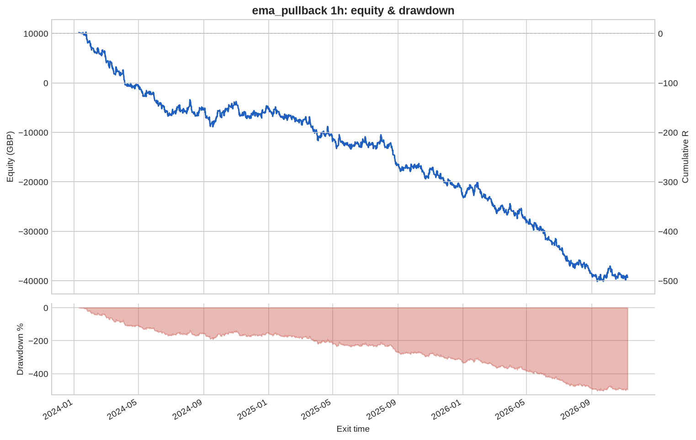
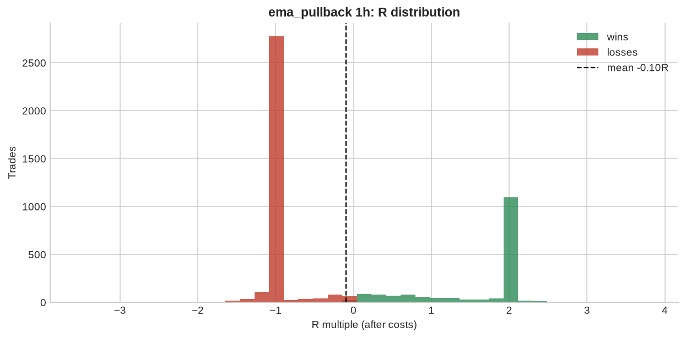

# ema_pullback 1h

**Parameters:** ema_fast=20, ema_mid=50, ema_slow=200, pullback_bars=3, rsi_max=70, sl_atr_buffer=0.5, rr=2.0, max_bars=48

**Costs modelled:** spread per instrument (config), slippage 0.2 pips/pts per side, commission 0.0 GBP/round trip, same-bar SL+TP → pessimistic.  
**Sizing:** 1.0% of GBP 10,000 per trade, fixed.

## Headline

| Metric | Value |
|---|---|
| Trades | 4,917 |
| Win rate | 34.9% |
| Expectancy (R) | -0.099 |
| Profit factor | 0.847 |
| Payoff ratio | 1.579 |
| Total R | -486.8 |
| Return % | -486.8 |
| Max drawdown (R) | 504.3 |
| Max drawdown % | 504.3 |
| Sharpe (daily) | -2.400 |
| t-stat of mean R | -5.335 |
| Avg bars held | 20.149 |
| Max consecutive losses | 26 |
| Trades / month | 143.5 |
| First trade | 2024-01-05 |
| Last trade | 2026-11-13 |

> Return below -100%: with fixed-size risk this strategy would have emptied the account. Read the R figures; the % is just arithmetic.

## By instrument

| instrument | trades | win_rate | expectancy_R | total_R | max_dd_R |
|---|---|---|---|---|---|
| AUDUSD | 484 | 0.347 | -0.100 | -48.406 | 57.776 |
| EURGBP | 451 | 0.304 | -0.231 | -104.3 | 119.1 |
| EURJPY | 447 | 0.347 | -0.106 | -47.414 | 50.280 |
| EURUSD | 474 | 0.363 | -0.043 | -20.570 | 34.314 |
| GBPJPY | 454 | 0.335 | -0.121 | -54.842 | 67.080 |
| GBPUSD | 469 | 0.341 | -0.139 | -65.347 | 69.343 |
| GER40 | 166 | 0.349 | -0.059 | -9.838 | 21.563 |
| JPN225 | 113 | 0.425 | 0.159 | 17.979 | 8.131 |
| NAS100 | 125 | 0.376 | -0.053 | -6.596 | 12.900 |
| SPX500 | 132 | 0.379 | -0.024 | -3.132 | 14.393 |
| UK100 | 187 | 0.358 | 0.005 | 1.000 | 20.425 |
| US30 | 130 | 0.338 | -0.127 | -16.567 | 19.683 |
| USDCAD | 400 | 0.400 | -0.003 | -1.083 | 44.377 |
| USDCHF | 446 | 0.323 | -0.195 | -87.063 | 95.486 |
| USDJPY | 439 | 0.353 | -0.092 | -40.584 | 46.609 |

## By year

| year | trades | win_rate | expectancy_R | total_R | max_dd_R |
|---|---|---|---|---|---|
| 2024 | 1,675 | 0.355 | -0.091 | -151.7 | 191.3 |
| 2025 | 1,715 | 0.341 | -0.103 | -177.3 | 180.6 |
| 2026 | 1,527 | 0.353 | -0.103 | -157.8 | 200.6 |

## By direction

| direction | trades | win_rate | expectancy_R | total_R | max_dd_R |
|---|---|---|---|---|---|
| long | 2,842 | 0.365 | -0.067 | -189.5 | 200.1 |
| short | 2,075 | 0.327 | -0.143 | -297.3 | 329.2 |

## By exit reason

| exit_reason | trades | win_rate | expectancy_R | total_R | max_dd_R |
|---|---|---|---|---|---|
| open_at_end | 14 | 0.643 | 0.461 | 6.448 | 0.517 |
| stop | 2,961 | 0.000 | -1.050 | -3,108.6 | 3,108.6 |
| target | 1,157 | 1.000 | 1.987 | 2,298.9 | 0.000 |
| time | 785 | 0.702 | 0.403 | 316.5 | 2.335 |

## By entry hour (UTC)

| entry_hour_utc | trades | win_rate | expectancy_R | total_R | max_dd_R |
|---|---|---|---|---|---|
| 0 | 146 | 0.356 | -0.016 | -2.382 | 17.397 |
| 1 | 271 | 0.413 | 0.079 | 21.364 | 14.469 |
| 2 | 164 | 0.341 | -0.098 | -16.055 | 32.832 |
| 3 | 138 | 0.304 | -0.221 | -30.513 | 32.090 |
| 4 | 145 | 0.303 | -0.170 | -24.603 | 34.222 |
| 5 | 128 | 0.398 | 0.107 | 13.687 | 10.946 |
| 6 | 156 | 0.308 | -0.160 | -24.958 | 34.490 |
| 7 | 213 | 0.352 | -0.013 | -2.866 | 20.617 |
| 8 | 356 | 0.309 | -0.191 | -67.940 | 70.818 |
| 9 | 271 | 0.280 | -0.287 | -77.727 | 78.196 |
| 10 | 222 | 0.387 | 0.013 | 2.884 | 18.489 |
| 11 | 187 | 0.326 | -0.134 | -25.104 | 40.263 |
| 12 | 229 | 0.349 | -0.105 | -24.042 | 26.495 |
| 13 | 314 | 0.430 | 0.048 | 15.048 | 28.125 |
| 14 | 392 | 0.355 | -0.116 | -45.587 | 57.210 |
| 15 | 411 | 0.370 | -0.089 | -36.455 | 54.403 |
| 16 | 287 | 0.408 | -0.023 | -6.674 | 35.788 |
| 17 | 191 | 0.366 | -0.101 | -19.365 | 26.545 |
| 18 | 182 | 0.341 | -0.071 | -12.875 | 35.327 |
| 19 | 182 | 0.319 | -0.151 | -27.450 | 40.349 |
| 20 | 134 | 0.291 | -0.259 | -34.682 | 50.434 |
| 21 | 96 | 0.229 | -0.421 | -40.376 | 40.376 |
| 22 | 48 | 0.312 | -0.152 | -7.278 | 12.026 |
| 23 | 54 | 0.278 | -0.237 | -12.808 | 17.618 |

## Monte Carlo (1000 runs)

| | p50 | p95 |
|---|---|---|
| Max drawdown, shuffled order (R) | 499.5 | 525.5 |
| Max drawdown, bootstrap (R) | 502.9 | 649.2 |

Bootstrap total R: p5 -630.5, p50 -489.2, p95 -333.6. Probability the edge is actually negative: **100%**.

---

_Backtests use mid/bid prices from free feeds, one position per instrument, no overnight financing, no margin limits. They are research, not a forecast and not advice._