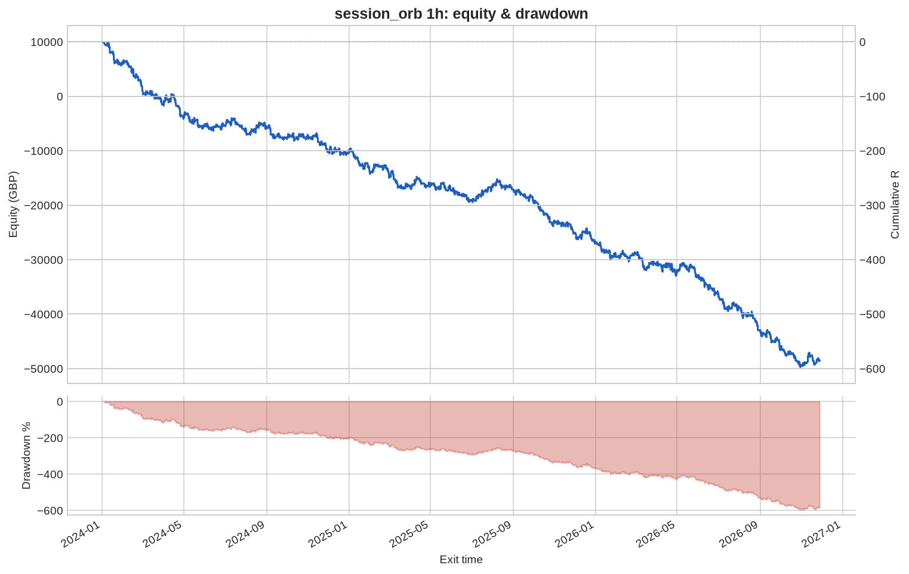
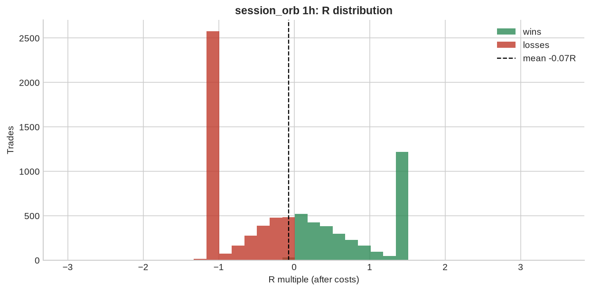

# session_orb 1h

**Parameters:** session=auto, range_bars=1, max_range_atr=1.5, min_bars_left=2, rr=1.5, flat_at_session_end=True

**Costs modelled:** spread per instrument (config), slippage 0.2 pips/pts per side, commission 0.0 GBP/round trip, same-bar SL+TP → pessimistic.  
**Sizing:** 1.0% of GBP 10,000 per trade, fixed.

## Headline

| Metric | Value |
|---|---|
| Trades | 7,884 |
| Win rate | 43.4% |
| Expectancy (R) | -0.074 |
| Profit factor | 0.826 |
| Payoff ratio | 1.076 |
| Total R | -585.3 |
| Return % | -585.3 |
| Max drawdown (R) | 597.4 |
| Max drawdown % | 597.4 |
| Sharpe (daily) | -3.271 |
| t-stat of mean R | -7.303 |
| Avg bars held | 2.965 |
| Max consecutive losses | 22 |
| Trades / month | 226.4 |
| First trade | 2024-01-02 |
| Last trade | 2026-11-27 |

> Return below -100%: with fixed-size risk this strategy would have emptied the account. Read the R figures; the % is just arithmetic.

## By instrument

| instrument | trades | win_rate | expectancy_R | total_R | max_dd_R |
|---|---|---|---|---|---|
| AUDUSD | 755 | 0.412 | -0.094 | -70.812 | 74.426 |
| EURGBP | 641 | 0.368 | -0.275 | -176.3 | 180.3 |
| EURJPY | 610 | 0.423 | -0.081 | -49.213 | 54.398 |
| EURUSD | 671 | 0.410 | -0.113 | -75.489 | 86.521 |
| GBPJPY | 621 | 0.459 | -0.020 | -12.471 | 24.163 |
| GBPUSD | 705 | 0.399 | -0.102 | -72.203 | 74.781 |
| GER40 | 585 | 0.489 | 0.046 | 26.952 | 25.703 |
| JPN225 | 241 | 0.419 | -0.078 | -18.692 | 21.114 |
| NAS100 | 387 | 0.501 | 0.017 | 6.541 | 9.292 |
| SPX500 | 436 | 0.470 | -0.012 | -5.179 | 10.304 |
| UK100 | 278 | 0.464 | -0.083 | -22.975 | 31.964 |
| US30 | 263 | 0.498 | 0.052 | 13.718 | 8.756 |
| USDCAD | 290 | 0.431 | -0.090 | -26.118 | 31.005 |
| USDCHF | 683 | 0.423 | -0.123 | -84.066 | 93.292 |
| USDJPY | 718 | 0.442 | -0.026 | -18.987 | 39.872 |

## By year

| year | trades | win_rate | expectancy_R | total_R | max_dd_R |
|---|---|---|---|---|---|
| 2024 | 2,721 | 0.436 | -0.073 | -198.4 | 208.3 |
| 2025 | 2,684 | 0.435 | -0.063 | -169.0 | 175.2 |
| 2026 | 2,479 | 0.431 | -0.088 | -217.9 | 230.1 |

## By direction

| direction | trades | win_rate | expectancy_R | total_R | max_dd_R |
|---|---|---|---|---|---|
| long | 4,130 | 0.446 | -0.070 | -288.0 | 291.3 |
| short | 3,754 | 0.421 | -0.079 | -297.2 | 322.7 |

## By exit reason

| exit_reason | trades | win_rate | expectancy_R | total_R | max_dd_R |
|---|---|---|---|---|---|
| session_end | 4,069 | 0.540 | 0.082 | 333.5 | 9.214 |
| stop | 2,591 | 0.000 | -1.045 | -2,706.8 | 2,706.8 |
| target | 1,224 | 1.000 | 1.461 | 1,788.0 | 0.000 |

## By entry hour (UTC)

| entry_hour_utc | trades | win_rate | expectancy_R | total_R | max_dd_R |
|---|---|---|---|---|---|
| 2 | 139 | 0.439 | -0.064 | -8.837 | 13.440 |
| 3 | 52 | 0.365 | -0.173 | -8.978 | 9.785 |
| 4 | 50 | 0.420 | -0.018 | -0.878 | 3.327 |
| 9 | 1,557 | 0.459 | -0.042 | -65.775 | 108.8 |
| 10 | 1,670 | 0.410 | -0.078 | -131.1 | 154.7 |
| 11 | 860 | 0.406 | -0.141 | -121.6 | 122.3 |
| 12 | 636 | 0.418 | -0.106 | -67.541 | 67.902 |
| 13 | 727 | 0.432 | -0.095 | -69.385 | 79.159 |
| 14 | 601 | 0.398 | -0.135 | -81.127 | 84.018 |
| 15 | 630 | 0.486 | -0.015 | -9.386 | 30.958 |
| 16 | 430 | 0.509 | 0.000 | 0.038 | 9.419 |
| 17 | 284 | 0.426 | -0.032 | -8.994 | 14.608 |
| 18 | 186 | 0.425 | -0.058 | -10.860 | 15.315 |
| 19 | 62 | 0.484 | -0.015 | -0.913 | 4.433 |

## Monte Carlo (1000 runs)

| | p50 | p95 |
|---|---|---|
| Max drawdown, shuffled order (R) | 593.6 | 609.7 |
| Max drawdown, bootstrap (R) | 591.2 | 723.0 |

Bootstrap total R: p5 -713.5, p50 -581.5, p95 -443.8. Probability the edge is actually negative: **100%**.

---

_Backtests use mid/bid prices from free feeds, one position per instrument, no overnight financing, no margin limits. They are research, not a forecast and not advice._