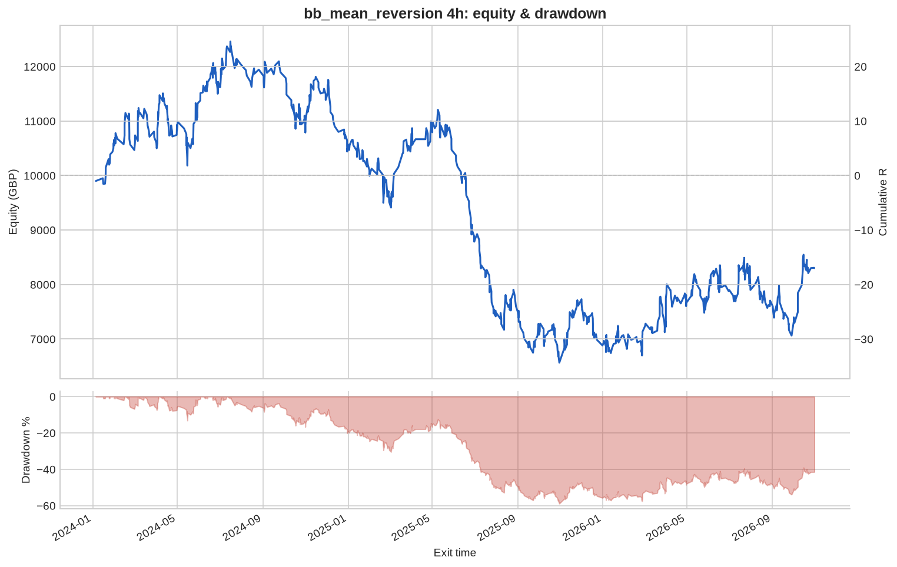
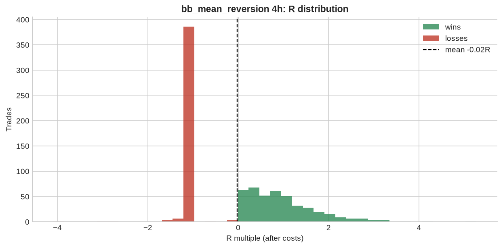

# bb_mean_reversion 4h

**Parameters:** period=20, std=2.0, adx_max=20, sl_atr_buffer=0.5, max_bars=30

**Costs modelled:** spread per instrument (config), slippage 0.2 pips/pts per side, commission 0.0 GBP/round trip, same-bar SL+TP → pessimistic.  
**Sizing:** 1.0% of GBP 10,000 per trade, fixed.

## Headline

| Metric | Value |
|---|---|
| Trades | 824 |
| Win rate | 51.0% |
| Expectancy (R) | -0.021 |
| Profit factor | 0.959 |
| Payoff ratio | 0.923 |
| Total R | -16.999 |
| Return % | -16.999 |
| Max drawdown (R) | 58.941 |
| Max drawdown % | 58.941 |
| Sharpe (daily) | -0.154 |
| t-stat of mean R | -0.516 |
| Avg bars held | 4.091 |
| Max consecutive losses | 11 |
| Trades / month | 24.352 |
| First trade | 2024-01-04 |
| Last trade | 2026-10-30 |

## By instrument

| instrument | trades | win_rate | expectancy_R | total_R | max_dd_R |
|---|---|---|---|---|---|
| AUDUSD | 65 | 0.554 | 0.092 | 5.980 | 7.613 |
| EURGBP | 68 | 0.471 | -0.166 | -11.278 | 15.849 |
| EURJPY | 80 | 0.388 | -0.341 | -27.296 | 29.860 |
| EURUSD | 61 | 0.475 | -0.050 | -3.029 | 12.397 |
| GBPJPY | 92 | 0.576 | 0.097 | 8.916 | 7.045 |
| GBPUSD | 73 | 0.521 | 0.093 | 6.812 | 8.658 |
| GER40 | 43 | 0.558 | 0.063 | 2.703 | 7.105 |
| JPN225 | 27 | 0.444 | -0.292 | -7.872 | 9.688 |
| NAS100 | 18 | 0.556 | -0.004 | -0.079 | 5.109 |
| SPX500 | 26 | 0.538 | 0.198 | 5.141 | 7.520 |
| UK100 | 47 | 0.511 | 0.041 | 1.913 | 6.781 |
| US30 | 32 | 0.531 | 0.070 | 2.245 | 7.058 |
| USDCAD | 55 | 0.564 | -0.007 | -0.371 | 6.088 |
| USDCHF | 76 | 0.566 | 0.125 | 9.476 | 6.789 |
| USDJPY | 61 | 0.426 | -0.168 | -10.260 | 14.412 |

## By year

| year | trades | win_rate | expectancy_R | total_R | max_dd_R |
|---|---|---|---|---|---|
| 2024 | 268 | 0.515 | 0.018 | 4.916 | 20.206 |
| 2025 | 307 | 0.479 | -0.118 | -36.111 | 46.416 |
| 2026 | 249 | 0.542 | 0.057 | 14.196 | 14.267 |

## By direction

| direction | trades | win_rate | expectancy_R | total_R | max_dd_R |
|---|---|---|---|---|---|
| long | 355 | 0.580 | 0.047 | 16.805 | 19.223 |
| short | 469 | 0.456 | -0.072 | -33.804 | 53.144 |

## By exit reason

| exit_reason | trades | win_rate | expectancy_R | total_R | max_dd_R |
|---|---|---|---|---|---|
| open_at_end | 2 | 0.500 | -0.004 | -0.008 | 0.065 |
| stop | 398 | 0.000 | -1.052 | -418.6 | 418.6 |
| target | 417 | 0.995 | 0.958 | 399.6 | 0.027 |
| time | 7 | 0.571 | 0.277 | 1.940 | 0.717 |

## By entry hour (UTC)

| entry_hour_utc | trades | win_rate | expectancy_R | total_R | max_dd_R |
|---|---|---|---|---|---|
| 0 | 144 | 0.396 | -0.102 | -14.738 | 28.308 |
| 4 | 136 | 0.507 | -0.039 | -5.273 | 17.538 |
| 8 | 112 | 0.607 | 0.211 | 23.667 | 7.141 |
| 12 | 138 | 0.478 | -0.117 | -16.128 | 30.436 |
| 16 | 145 | 0.524 | -0.115 | -16.627 | 23.729 |
| 20 | 149 | 0.564 | 0.081 | 12.100 | 17.010 |

## Monte Carlo (1000 runs)

| | p50 | p95 |
|---|---|---|
| Max drawdown, shuffled order (R) | 43.0 | 61.3 |
| Max drawdown, bootstrap (R) | 45.1 | 86.4 |

Bootstrap total R: p5 -73.5, p50 -19.3, p95 +39.0. Probability the edge is actually negative: **72%**.

---

_Backtests use mid/bid prices from free feeds, one position per instrument, no overnight financing, no margin limits. They are research, not a forecast and not advice._