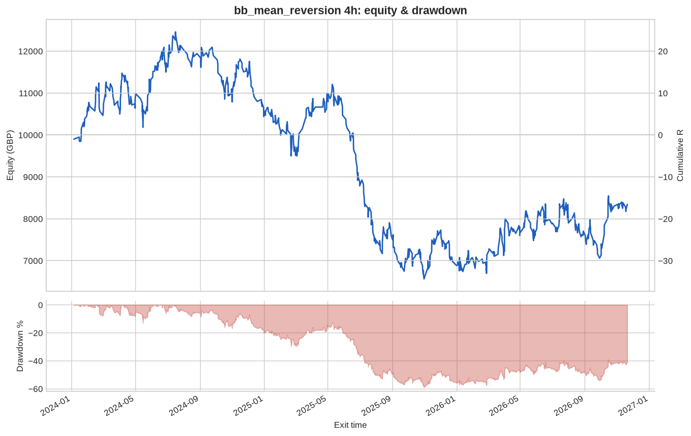
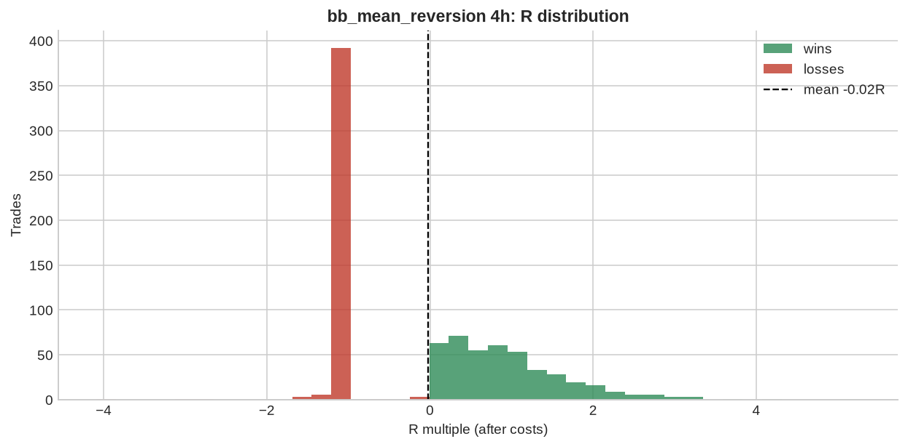

# bb_mean_reversion 4h

**Parameters:** period=20, std=2.0, adx_max=20, sl_atr_buffer=0.5, max_bars=30

**Costs modelled:** spread per instrument (config), slippage 0.2 pips/pts per side, commission 0.0 GBP/round trip, same-bar SL+TP → pessimistic.  
**Sizing:** 1.0% of GBP 10,000 per trade, fixed.

## Headline

| Metric | Value |
|---|---|
| Trades | 838 |
| Win rate | 51.2% |
| Expectancy (R) | -0.020 |
| Profit factor | 0.961 |
| Payoff ratio | 0.916 |
| Total R | -16.560 |
| Return % | -16.560 |
| Max drawdown (R) | 59.174 |
| Max drawdown % | 59.174 |
| Sharpe (daily) | -0.145 |
| t-stat of mean R | -0.500 |
| Avg bars held | 4.073 |
| Max consecutive losses | 11 |
| Trades / month | 24.294 |
| First trade | 2024-01-04 |
| Last trade | 2026-11-20 |

## By instrument

| instrument | trades | win_rate | expectancy_R | total_R | max_dd_R |
|---|---|---|---|---|---|
| AUDUSD | 66 | 0.545 | 0.075 | 4.951 | 7.613 |
| EURGBP | 72 | 0.472 | -0.159 | -11.482 | 16.913 |
| EURJPY | 80 | 0.388 | -0.341 | -27.296 | 29.860 |
| EURUSD | 61 | 0.475 | -0.050 | -3.029 | 12.397 |
| GBPJPY | 92 | 0.576 | 0.097 | 8.916 | 7.045 |
| GBPUSD | 73 | 0.521 | 0.093 | 6.812 | 8.658 |
| GER40 | 43 | 0.535 | 0.038 | 1.644 | 7.105 |
| JPN225 | 27 | 0.444 | -0.292 | -7.872 | 9.688 |
| NAS100 | 18 | 0.556 | -0.004 | -0.079 | 5.109 |
| SPX500 | 27 | 0.556 | 0.209 | 5.656 | 7.520 |
| UK100 | 49 | 0.531 | 0.054 | 2.648 | 6.781 |
| US30 | 33 | 0.545 | 0.072 | 2.377 | 7.058 |
| USDCAD | 55 | 0.564 | -0.007 | -0.371 | 6.088 |
| USDCHF | 76 | 0.566 | 0.125 | 9.476 | 6.789 |
| USDJPY | 66 | 0.455 | -0.135 | -8.910 | 14.412 |

## By year

| year | trades | win_rate | expectancy_R | total_R | max_dd_R |
|---|---|---|---|---|---|
| 2024 | 268 | 0.515 | 0.018 | 4.916 | 20.439 |
| 2025 | 307 | 0.479 | -0.118 | -36.111 | 46.416 |
| 2026 | 263 | 0.548 | 0.056 | 14.635 | 14.124 |

## By direction

| direction | trades | win_rate | expectancy_R | total_R | max_dd_R |
|---|---|---|---|---|---|
| long | 362 | 0.583 | 0.044 | 15.897 | 19.223 |
| short | 476 | 0.458 | -0.068 | -32.457 | 53.876 |

## By exit reason

| exit_reason | trades | win_rate | expectancy_R | total_R | max_dd_R |
|---|---|---|---|---|---|
| stop | 404 | 0.000 | -1.051 | -424.8 | 424.8 |
| target | 427 | 0.995 | 0.952 | 406.3 | 0.027 |
| time | 7 | 0.571 | 0.277 | 1.940 | 0.717 |

## By entry hour (UTC)

| entry_hour_utc | trades | win_rate | expectancy_R | total_R | max_dd_R |
|---|---|---|---|---|---|
| 0 | 147 | 0.401 | -0.090 | -13.239 | 28.308 |
| 4 | 136 | 0.507 | -0.039 | -5.273 | 17.538 |
| 8 | 113 | 0.611 | 0.205 | 23.154 | 7.141 |
| 12 | 139 | 0.475 | -0.119 | -16.573 | 30.436 |
| 16 | 152 | 0.539 | -0.096 | -14.576 | 23.826 |
| 20 | 151 | 0.556 | 0.066 | 9.947 | 17.010 |

## Monte Carlo (1000 runs)

| | p50 | p95 |
|---|---|---|
| Max drawdown, shuffled order (R) | 42.3 | 60.3 |
| Max drawdown, bootstrap (R) | 43.5 | 82.7 |

Bootstrap total R: p5 -70.2, p50 -14.8, p95 +39.3. Probability the edge is actually negative: **67%**.

---

_Backtests use mid/bid prices from free feeds, one position per instrument, no overnight financing, no margin limits. They are research, not a forecast and not advice._