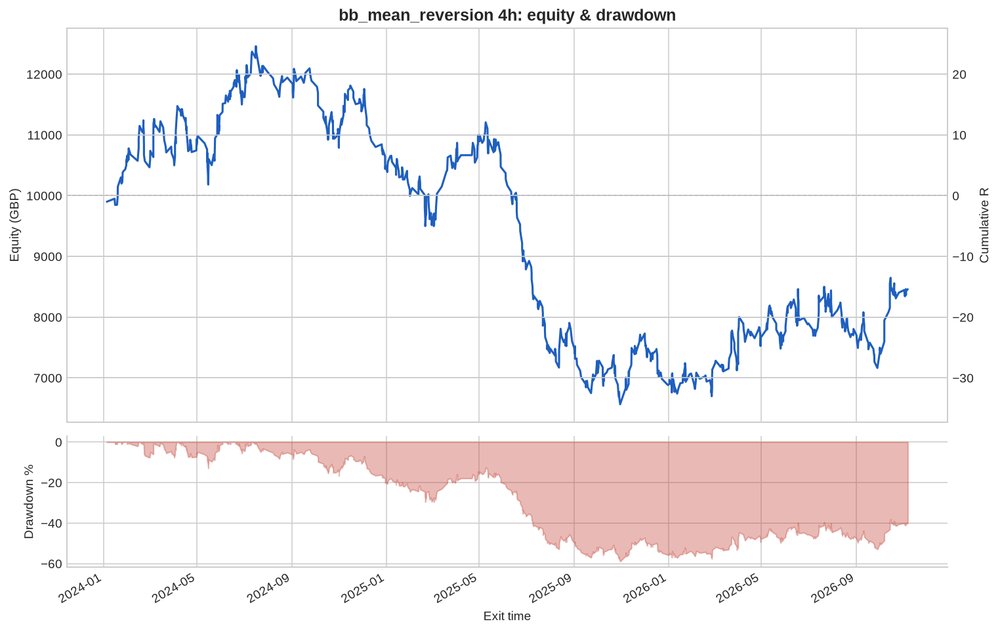
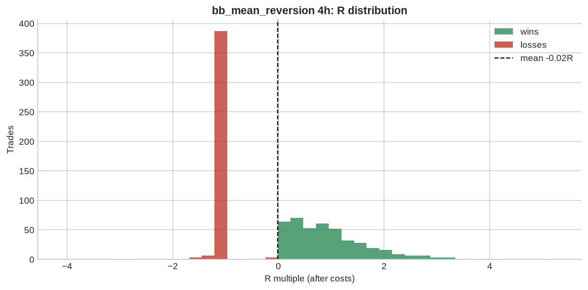

# bb_mean_reversion 4h

**Parameters:** period=20, std=2.0, adx_max=20, sl_atr_buffer=0.5, max_bars=30

**Costs modelled:** spread per instrument (config), slippage 0.2 pips/pts per side, commission 0.0 GBP/round trip, same-bar SL+TP → pessimistic.  
**Sizing:** 1.0% of GBP 10,000 per trade, fixed.

## Headline

| Metric | Value |
|---|---|
| Trades | 834 |
| Win rate | 51.2% |
| Expectancy (R) | -0.019 |
| Profit factor | 0.963 |
| Payoff ratio | 0.918 |
| Total R | -15.465 |
| Return % | -15.465 |
| Max drawdown (R) | 59.174 |
| Max drawdown % | 59.174 |
| Sharpe (daily) | -0.128 |
| t-stat of mean R | -0.468 |
| Avg bars held | 4.074 |
| Max consecutive losses | 11 |
| Trades / month | 24.317 |
| First trade | 2024-01-04 |
| Last trade | 2026-11-13 |

## By instrument

| instrument | trades | win_rate | expectancy_R | total_R | max_dd_R |
|---|---|---|---|---|---|
| AUDUSD | 66 | 0.545 | 0.075 | 4.950 | 7.613 |
| EURGBP | 72 | 0.472 | -0.149 | -10.707 | 16.912 |
| EURJPY | 80 | 0.388 | -0.341 | -27.296 | 29.860 |
| EURUSD | 61 | 0.475 | -0.050 | -3.033 | 12.397 |
| GBPJPY | 92 | 0.576 | 0.097 | 8.917 | 7.045 |
| GBPUSD | 73 | 0.521 | 0.093 | 6.808 | 8.658 |
| GER40 | 43 | 0.535 | 0.038 | 1.644 | 7.105 |
| JPN225 | 27 | 0.444 | -0.292 | -7.872 | 9.688 |
| NAS100 | 18 | 0.556 | -0.004 | -0.079 | 5.109 |
| SPX500 | 26 | 0.577 | 0.256 | 6.664 | 7.520 |
| UK100 | 49 | 0.531 | 0.054 | 2.648 | 6.781 |
| US30 | 33 | 0.545 | 0.072 | 2.376 | 7.058 |
| USDCAD | 55 | 0.564 | -0.007 | -0.369 | 6.086 |
| USDCHF | 76 | 0.566 | 0.125 | 9.477 | 6.788 |
| USDJPY | 63 | 0.444 | -0.152 | -9.593 | 14.412 |

## By year

| year | trades | win_rate | expectancy_R | total_R | max_dd_R |
|---|---|---|---|---|---|
| 2024 | 268 | 0.515 | 0.018 | 4.916 | 20.439 |
| 2025 | 307 | 0.479 | -0.118 | -36.111 | 46.416 |
| 2026 | 259 | 0.548 | 0.061 | 15.730 | 13.261 |

## By direction

| direction | trades | win_rate | expectancy_R | total_R | max_dd_R |
|---|---|---|---|---|---|
| long | 359 | 0.585 | 0.050 | 18.075 | 19.223 |
| short | 475 | 0.457 | -0.071 | -33.540 | 53.140 |

## By exit reason

| exit_reason | trades | win_rate | expectancy_R | total_R | max_dd_R |
|---|---|---|---|---|---|
| open_at_end | 1 | 0.000 | -0.302 | -0.302 | 0.302 |
| stop | 401 | 0.000 | -1.052 | -421.7 | 421.7 |
| target | 425 | 0.995 | 0.952 | 404.6 | 0.027 |
| time | 7 | 0.571 | 0.277 | 1.940 | 0.717 |

## By entry hour (UTC)

| entry_hour_utc | trades | win_rate | expectancy_R | total_R | max_dd_R |
|---|---|---|---|---|---|
| 0 | 147 | 0.401 | -0.090 | -13.238 | 28.308 |
| 4 | 136 | 0.507 | -0.039 | -5.280 | 17.538 |
| 8 | 112 | 0.616 | 0.216 | 24.170 | 7.141 |
| 12 | 139 | 0.475 | -0.119 | -16.572 | 30.435 |
| 16 | 149 | 0.537 | -0.102 | -15.268 | 22.818 |
| 20 | 151 | 0.556 | 0.071 | 10.724 | 17.010 |

## Monte Carlo (1000 runs)

| | p50 | p95 |
|---|---|---|
| Max drawdown, shuffled order (R) | 41.9 | 61.3 |
| Max drawdown, bootstrap (R) | 43.6 | 82.3 |

Bootstrap total R: p5 -65.2, p50 -15.8, p95 +35.0. Probability the edge is actually negative: **68%**.

---

_Backtests use mid/bid prices from free feeds, one position per instrument, no overnight financing, no margin limits. They are research, not a forecast and not advice._