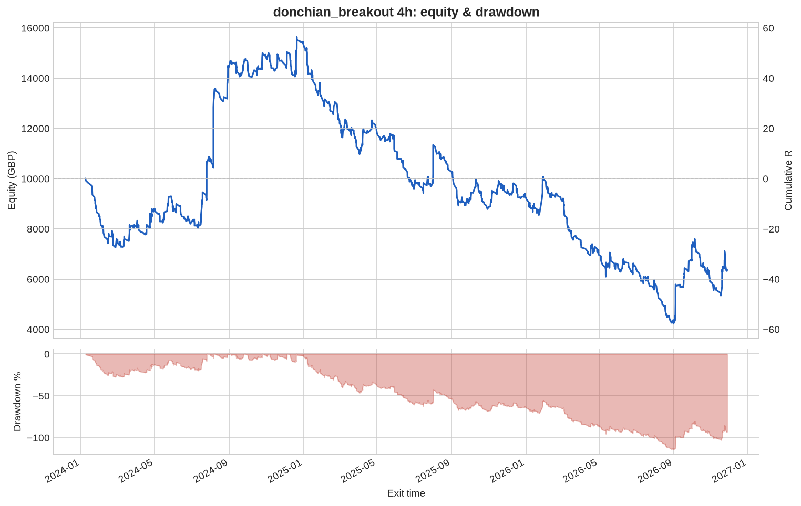
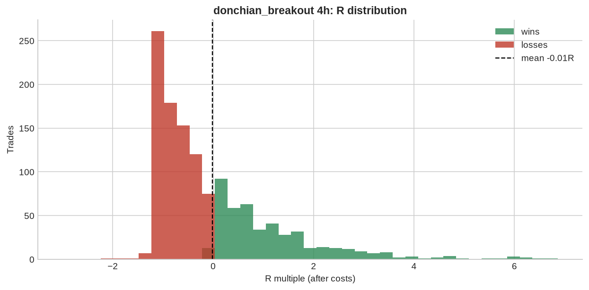

# donchian_breakout 4h

**Parameters:** lookback=20, adx_min=20, sl_atr=2.0, trail_atr=2.0, rr=None, max_bars=200

**Costs modelled:** spread per instrument (config), slippage 0.2 pips/pts per side, commission 0.0 GBP/round trip, same-bar SL+TP → pessimistic.  
**Sizing:** 1.0% of GBP 10,000 per trade, fixed.

## Headline

| Metric | Value |
|---|---|
| Trades | 1,258 |
| Win rate | 36.6% |
| Expectancy (R) | -0.013 |
| Profit factor | 0.971 |
| Payoff ratio | 1.685 |
| Total R | -16.610 |
| Return % | -16.610 |
| Max drawdown (R) | 112.4 |
| Max drawdown % | 112.4 |
| Sharpe (daily) | -0.133 |
| t-stat of mean R | -0.384 |
| Avg bars held | 13.931 |
| Max consecutive losses | 15 |
| Trades / month | 36.366 |
| First trade | 2024-01-02 |
| Last trade | 2026-11-20 |

## By instrument

| instrument | trades | win_rate | expectancy_R | total_R | max_dd_R |
|---|---|---|---|---|---|
| AUDUSD | 116 | 0.328 | -0.070 | -8.067 | 18.945 |
| EURGBP | 109 | 0.220 | -0.225 | -24.510 | 26.235 |
| EURJPY | 101 | 0.426 | 0.065 | 6.583 | 10.272 |
| EURUSD | 111 | 0.342 | -0.051 | -5.664 | 8.024 |
| GBPJPY | 106 | 0.377 | -0.029 | -3.023 | 19.517 |
| GBPUSD | 108 | 0.435 | 0.137 | 14.751 | 7.712 |
| GER40 | 50 | 0.420 | 0.035 | 1.726 | 13.536 |
| JPN225 | 43 | 0.395 | -0.042 | -1.797 | 11.007 |
| NAS100 | 54 | 0.315 | -0.097 | -5.236 | 11.665 |
| SPX500 | 48 | 0.333 | -0.149 | -7.163 | 14.743 |
| UK100 | 48 | 0.521 | 0.149 | 7.169 | 4.132 |
| US30 | 43 | 0.488 | 0.136 | 5.858 | 6.665 |
| USDCAD | 107 | 0.308 | -0.013 | -1.381 | 17.685 |
| USDCHF | 107 | 0.364 | -0.008 | -0.881 | 18.316 |
| USDJPY | 107 | 0.383 | 0.047 | 5.025 | 14.332 |

## By year

| year | trades | win_rate | expectancy_R | total_R | max_dd_R |
|---|---|---|---|---|---|
| 2024 | 414 | 0.394 | 0.129 | 53.423 | 27.928 |
| 2025 | 446 | 0.345 | -0.136 | -60.726 | 65.559 |
| 2026 | 398 | 0.359 | -0.023 | -9.307 | 57.640 |

## By direction

| direction | trades | win_rate | expectancy_R | total_R | max_dd_R |
|---|---|---|---|---|---|
| long | 649 | 0.391 | 0.015 | 10.045 | 30.691 |
| short | 609 | 0.338 | -0.044 | -26.655 | 92.227 |

## By exit reason

| exit_reason | trades | win_rate | expectancy_R | total_R | max_dd_R |
|---|---|---|---|---|---|
| open_at_end | 9 | 1.000 | 1.945 | 17.502 | 0.000 |
| stop | 246 | 0.000 | -1.025 | -252.1 | 252.1 |
| time | 1 | 1.000 | 3.392 | 3.392 | 0.000 |
| trail_stop | 1,002 | 0.449 | 0.214 | 214.6 | 14.640 |

## By entry hour (UTC)

| entry_hour_utc | trades | win_rate | expectancy_R | total_R | max_dd_R |
|---|---|---|---|---|---|
| 0 | 69 | 0.391 | 0.291 | 20.095 | 11.320 |
| 4 | 209 | 0.368 | -0.072 | -15.050 | 21.637 |
| 8 | 196 | 0.383 | 0.093 | 18.185 | 12.461 |
| 12 | 239 | 0.418 | 0.052 | 12.340 | 25.606 |
| 16 | 388 | 0.351 | -0.060 | -23.247 | 44.640 |
| 20 | 157 | 0.287 | -0.184 | -28.932 | 39.435 |

## Monte Carlo (1000 runs)

| | p50 | p95 |
|---|---|---|
| Max drawdown, shuffled order (R) | 52.7 | 77.5 |
| Max drawdown, bootstrap (R) | 56.2 | 105.7 |

Bootstrap total R: p5 -88.0, p50 -17.3, p95 +57.3. Probability the edge is actually negative: **66%**.

---

_Backtests use mid/bid prices from free feeds, one position per instrument, no overnight financing, no margin limits. They are research, not a forecast and not advice._