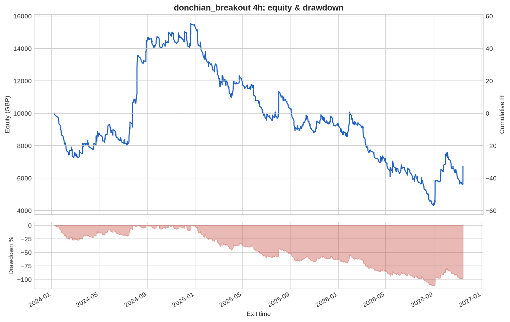
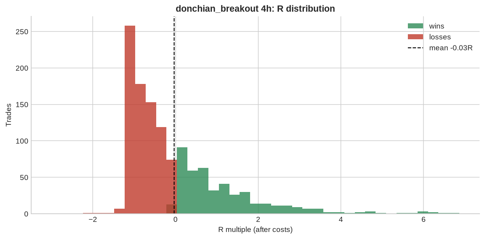

# donchian_breakout 4h

**Parameters:** lookback=20, adx_min=20, sl_atr=2.0, trail_atr=2.0, rr=None, max_bars=200

**Costs modelled:** spread per instrument (config), slippage 0.2 pips/pts per side, commission 0.0 GBP/round trip, same-bar SL+TP → pessimistic.  
**Sizing:** 1.0% of GBP 10,000 per trade, fixed.

## Headline

| Metric | Value |
|---|---|
| Trades | 1,246 |
| Win rate | 36.1% |
| Expectancy (R) | -0.026 |
| Profit factor | 0.943 |
| Payoff ratio | 1.668 |
| Total R | -32.545 |
| Return % | -32.545 |
| Max drawdown (R) | 113.4 |
| Max drawdown % | 113.4 |
| Sharpe (daily) | -0.312 |
| t-stat of mean R | -0.764 |
| Avg bars held | 13.892 |
| Max consecutive losses | 15 |
| Trades / month | 36.260 |
| First trade | 2024-01-02 |
| Last trade | 2026-11-13 |

## By instrument

| instrument | trades | win_rate | expectancy_R | total_R | max_dd_R |
|---|---|---|---|---|---|
| AUDUSD | 115 | 0.322 | -0.091 | -10.498 | 18.945 |
| EURGBP | 108 | 0.213 | -0.228 | -24.657 | 26.235 |
| EURJPY | 100 | 0.420 | 0.059 | 5.896 | 10.272 |
| EURUSD | 111 | 0.342 | -0.054 | -6.033 | 8.024 |
| GBPJPY | 104 | 0.365 | -0.044 | -4.543 | 19.517 |
| GBPUSD | 108 | 0.435 | 0.118 | 12.712 | 7.712 |
| GER40 | 49 | 0.408 | -0.002 | -0.105 | 12.635 |
| JPN225 | 43 | 0.395 | -0.042 | -1.797 | 11.007 |
| NAS100 | 52 | 0.308 | -0.116 | -6.023 | 11.665 |
| SPX500 | 47 | 0.319 | -0.190 | -8.935 | 14.743 |
| UK100 | 46 | 0.522 | 0.125 | 5.752 | 4.132 |
| US30 | 42 | 0.476 | 0.081 | 3.394 | 6.665 |
| USDCAD | 107 | 0.308 | -0.017 | -1.833 | 17.685 |
| USDCHF | 107 | 0.364 | -0.008 | -0.899 | 18.316 |
| USDJPY | 107 | 0.383 | 0.047 | 5.025 | 14.332 |

## By year

| year | trades | win_rate | expectancy_R | total_R | max_dd_R |
|---|---|---|---|---|---|
| 2024 | 414 | 0.394 | 0.129 | 53.423 | 27.457 |
| 2025 | 446 | 0.345 | -0.136 | -60.726 | 65.559 |
| 2026 | 386 | 0.345 | -0.065 | -25.242 | 57.640 |

## By direction

| direction | trades | win_rate | expectancy_R | total_R | max_dd_R |
|---|---|---|---|---|---|
| long | 647 | 0.391 | 0.018 | 11.336 | 30.691 |
| short | 599 | 0.329 | -0.073 | -43.881 | 93.234 |

## By exit reason

| exit_reason | trades | win_rate | expectancy_R | total_R | max_dd_R |
|---|---|---|---|---|---|
| open_at_end | 7 | 0.857 | 1.570 | 10.991 | 0.249 |
| stop | 244 | 0.000 | -1.024 | -249.9 | 249.9 |
| time | 1 | 1.000 | 3.392 | 3.392 | 0.000 |
| trail_stop | 994 | 0.446 | 0.204 | 203.0 | 14.640 |

## By entry hour (UTC)

| entry_hour_utc | trades | win_rate | expectancy_R | total_R | max_dd_R |
|---|---|---|---|---|---|
| 0 | 67 | 0.373 | 0.237 | 15.891 | 11.320 |
| 4 | 209 | 0.368 | -0.074 | -15.419 | 21.637 |
| 8 | 195 | 0.379 | 0.092 | 17.986 | 12.461 |
| 12 | 235 | 0.413 | 0.049 | 11.552 | 25.606 |
| 16 | 385 | 0.348 | -0.077 | -29.513 | 44.640 |
| 20 | 155 | 0.277 | -0.213 | -33.041 | 39.435 |

## Monte Carlo (1000 runs)

| | p50 | p95 |
|---|---|---|
| Max drawdown, shuffled order (R) | 62.5 | 85.5 |
| Max drawdown, bootstrap (R) | 65.1 | 122.2 |

Bootstrap total R: p5 -106.8, p50 -34.3, p95 +43.5. Probability the edge is actually negative: **78%**.

---

_Backtests use mid/bid prices from free feeds, one position per instrument, no overnight financing, no margin limits. They are research, not a forecast and not advice._