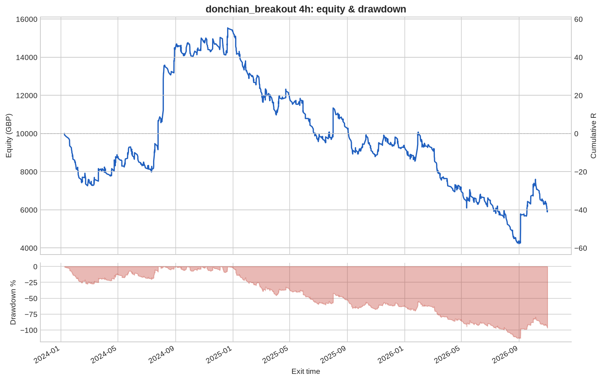
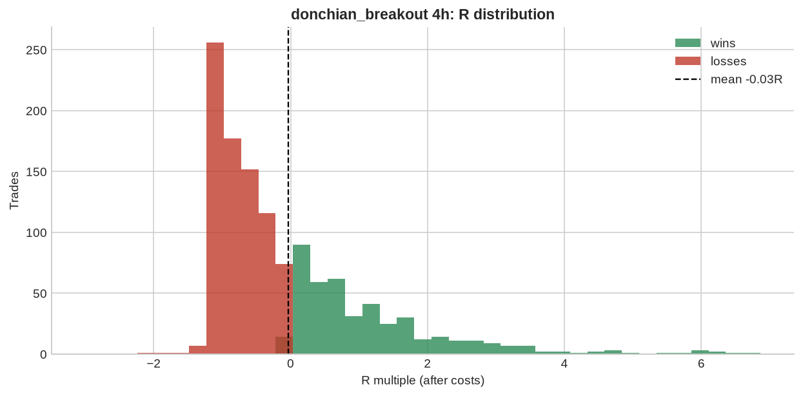

# donchian_breakout 4h

**Parameters:** lookback=20, adx_min=20, sl_atr=2.0, trail_atr=2.0, rr=None, max_bars=200

**Costs modelled:** spread per instrument (config), slippage 0.2 pips/pts per side, commission 0.0 GBP/round trip, same-bar SL+TP → pessimistic.  
**Sizing:** 1.0% of GBP 10,000 per trade, fixed.

## Headline

| Metric | Value |
|---|---|
| Trades | 1,228 |
| Win rate | 36.1% |
| Expectancy (R) | -0.033 |
| Profit factor | 0.929 |
| Payoff ratio | 1.645 |
| Total R | -40.395 |
| Return % | -40.395 |
| Max drawdown (R) | 113.2 |
| Max drawdown % | 113.2 |
| Sharpe (daily) | -0.408 |
| t-stat of mean R | -0.958 |
| Avg bars held | 13.906 |
| Max consecutive losses | 15 |
| Trades / month | 36.221 |
| First trade | 2024-01-02 |
| Last trade | 2026-10-30 |

## By instrument

| instrument | trades | win_rate | expectancy_R | total_R | max_dd_R |
|---|---|---|---|---|---|
| AUDUSD | 112 | 0.312 | -0.117 | -13.064 | 18.941 |
| EURGBP | 108 | 0.222 | -0.219 | -23.661 | 26.240 |
| EURJPY | 98 | 0.408 | 0.051 | 5.010 | 10.272 |
| EURUSD | 110 | 0.336 | -0.064 | -7.022 | 8.024 |
| GBPJPY | 104 | 0.356 | -0.058 | -6.060 | 19.514 |
| GBPUSD | 105 | 0.438 | 0.108 | 11.385 | 7.709 |
| GER40 | 47 | 0.426 | 0.024 | 1.147 | 11.383 |
| JPN225 | 41 | 0.415 | 0.004 | 0.159 | 9.746 |
| NAS100 | 51 | 0.333 | -0.120 | -6.145 | 11.665 |
| SPX500 | 47 | 0.319 | -0.190 | -8.931 | 14.743 |
| UK100 | 46 | 0.522 | 0.125 | 5.752 | 4.132 |
| US30 | 42 | 0.476 | 0.081 | 3.394 | 6.665 |
| USDCAD | 106 | 0.302 | -0.057 | -6.003 | 17.685 |
| USDCHF | 104 | 0.365 | -0.013 | -1.381 | 17.818 |
| USDJPY | 107 | 0.383 | 0.047 | 5.025 | 14.332 |

## By year

| year | trades | win_rate | expectancy_R | total_R | max_dd_R |
|---|---|---|---|---|---|
| 2024 | 414 | 0.394 | 0.129 | 53.423 | 27.457 |
| 2025 | 446 | 0.345 | -0.136 | -60.726 | 65.559 |
| 2026 | 368 | 0.342 | -0.090 | -33.092 | 58.531 |

## By direction

| direction | trades | win_rate | expectancy_R | total_R | max_dd_R |
|---|---|---|---|---|---|
| long | 641 | 0.388 | 0.007 | 4.595 | 30.691 |
| short | 587 | 0.330 | -0.077 | -44.990 | 92.991 |

## By exit reason

| exit_reason | trades | win_rate | expectancy_R | total_R | max_dd_R |
|---|---|---|---|---|---|
| open_at_end | 3 | 0.667 | 0.217 | 0.651 | 0.100 |
| stop | 242 | 0.000 | -1.024 | -247.9 | 247.9 |
| time | 1 | 1.000 | 3.392 | 3.392 | 0.000 |
| trail_stop | 982 | 0.448 | 0.207 | 203.5 | 14.640 |

## By entry hour (UTC)

| entry_hour_utc | trades | win_rate | expectancy_R | total_R | max_dd_R |
|---|---|---|---|---|---|
| 0 | 65 | 0.354 | 0.151 | 9.795 | 11.320 |
| 4 | 203 | 0.374 | -0.064 | -12.895 | 18.124 |
| 8 | 194 | 0.376 | 0.089 | 17.239 | 12.461 |
| 12 | 232 | 0.418 | 0.056 | 13.007 | 25.606 |
| 16 | 382 | 0.348 | -0.089 | -34.166 | 45.566 |
| 20 | 152 | 0.270 | -0.220 | -33.375 | 40.127 |

## Monte Carlo (1000 runs)

| | p50 | p95 |
|---|---|---|
| Max drawdown, shuffled order (R) | 65.3 | 90.5 |
| Max drawdown, bootstrap (R) | 68.9 | 123.9 |

Bootstrap total R: p5 -107.5, p50 -41.7, p95 +26.2. Probability the edge is actually negative: **84%**.

---

_Backtests use mid/bid prices from free feeds, one position per instrument, no overnight financing, no margin limits. They are research, not a forecast and not advice._