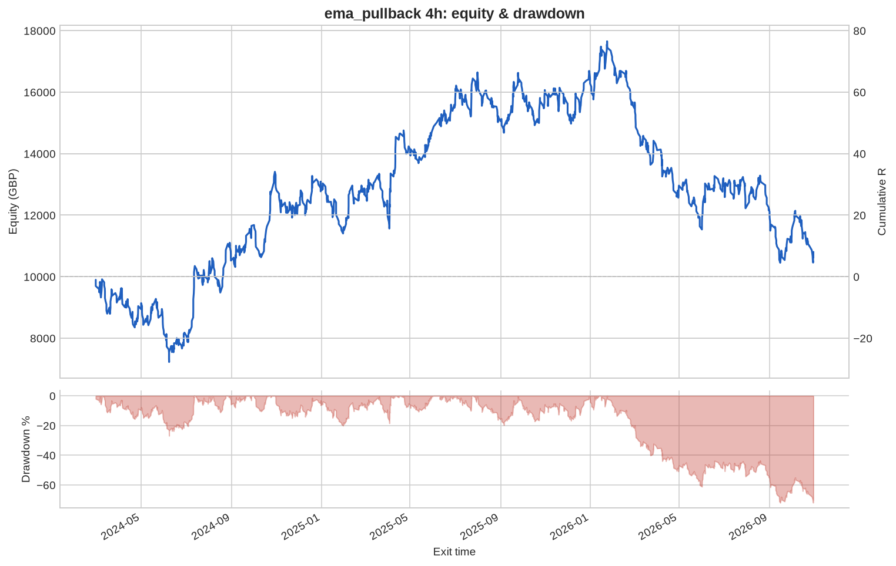
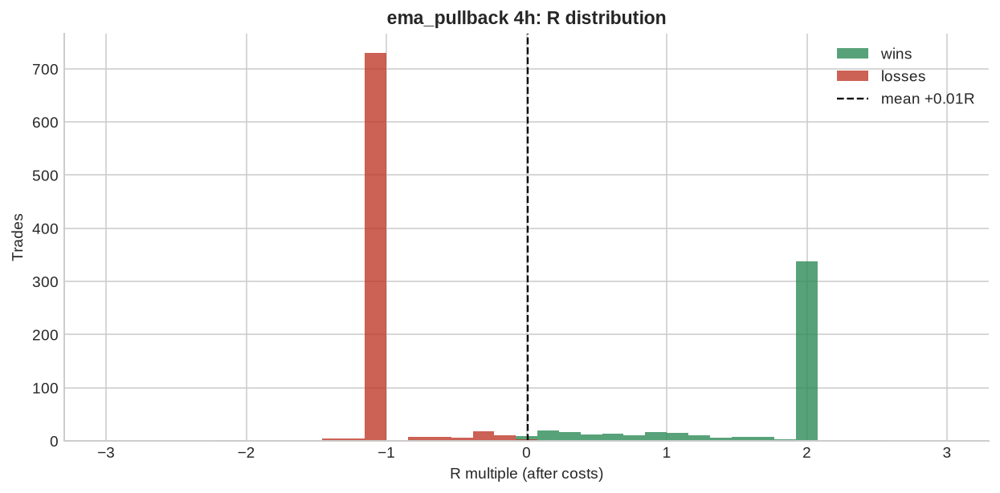

# ema_pullback 4h

**Parameters:** ema_fast=20, ema_mid=50, ema_slow=200, pullback_bars=3, rsi_max=70, sl_atr_buffer=0.5, rr=2.0, max_bars=48

**Costs modelled:** spread per instrument (config), slippage 0.2 pips/pts per side, commission 0.0 GBP/round trip, same-bar SL+TP → pessimistic.  
**Sizing:** 1.0% of GBP 10,000 per trade, fixed.

## Headline

| Metric | Value |
|---|---|
| Trades | 1,287 |
| Win rate | 38.0% |
| Expectancy (R) | 0.006 |
| Profit factor | 1.010 |
| Payoff ratio | 1.649 |
| Total R | 7.975 |
| Return % | 7.975 |
| Max drawdown (R) | 71.984 |
| Max drawdown % | 71.984 |
| Sharpe (daily) | 0.111 |
| t-stat of mean R | 0.167 |
| Avg bars held | 19.538 |
| Max consecutive losses | 14 |
| Trades / month | 39.935 |
| First trade | 2024-02-22 |
| Last trade | 2026-10-30 |

## By instrument

| instrument | trades | win_rate | expectancy_R | total_R | max_dd_R |
|---|---|---|---|---|---|
| AUDUSD | 105 | 0.352 | -0.083 | -8.694 | 19.691 |
| EURGBP | 103 | 0.330 | -0.138 | -14.169 | 20.141 |
| EURJPY | 126 | 0.333 | -0.057 | -7.244 | 20.929 |
| EURUSD | 125 | 0.384 | 0.031 | 3.912 | 16.053 |
| GBPJPY | 122 | 0.320 | -0.164 | -20.018 | 29.827 |
| GBPUSD | 114 | 0.351 | -0.051 | -5.783 | 11.291 |
| GER40 | 59 | 0.322 | -0.127 | -7.507 | 12.641 |
| JPN225 | 36 | 0.500 | 0.347 | 12.498 | 7.203 |
| NAS100 | 33 | 0.545 | 0.308 | 10.161 | 3.652 |
| SPX500 | 39 | 0.462 | 0.174 | 6.800 | 5.062 |
| UK100 | 54 | 0.444 | 0.198 | 10.687 | 11.113 |
| US30 | 39 | 0.410 | 0.100 | 3.890 | 4.939 |
| USDCAD | 100 | 0.410 | 0.093 | 9.265 | 9.549 |
| USDCHF | 118 | 0.415 | 0.062 | 7.303 | 29.119 |
| USDJPY | 114 | 0.404 | 0.060 | 6.874 | 10.680 |

## By year

| year | trades | win_rate | expectancy_R | total_R | max_dd_R |
|---|---|---|---|---|---|
| 2024 | 411 | 0.399 | 0.069 | 28.399 | 27.754 |
| 2025 | 479 | 0.405 | 0.072 | 34.414 | 19.652 |
| 2026 | 397 | 0.330 | -0.138 | -54.838 | 71.984 |

## By direction

| direction | trades | win_rate | expectancy_R | total_R | max_dd_R |
|---|---|---|---|---|---|
| long | 822 | 0.398 | 0.034 | 28.307 | 33.158 |
| short | 465 | 0.348 | -0.044 | -20.332 | 62.062 |

## By exit reason

| exit_reason | trades | win_rate | expectancy_R | total_R | max_dd_R |
|---|---|---|---|---|---|
| open_at_end | 7 | 0.429 | 0.203 | 1.419 | 0.274 |
| stop | 744 | 0.000 | -1.024 | -762.1 | 762.1 |
| target | 341 | 1.000 | 1.989 | 678.3 | 0.000 |
| time | 195 | 0.744 | 0.464 | 90.414 | 2.610 |

## By entry hour (UTC)

| entry_hour_utc | trades | win_rate | expectancy_R | total_R | max_dd_R |
|---|---|---|---|---|---|
| 0 | 88 | 0.273 | -0.255 | -22.406 | 22.406 |
| 4 | 235 | 0.413 | 0.113 | 26.578 | 18.092 |
| 8 | 219 | 0.342 | -0.093 | -20.322 | 29.387 |
| 12 | 254 | 0.398 | 0.092 | 23.261 | 17.311 |
| 16 | 375 | 0.405 | 0.053 | 19.919 | 25.971 |
| 20 | 116 | 0.345 | -0.164 | -19.055 | 19.055 |

## Monte Carlo (1000 runs)

| | p50 | p95 |
|---|---|---|
| Max drawdown, shuffled order (R) | 48.6 | 73.8 |
| Max drawdown, bootstrap (R) | 49.7 | 97.4 |

Bootstrap total R: p5 -68.8, p50 +10.3, p95 +92.6. Probability the edge is actually negative: **42%**.

---

_Backtests use mid/bid prices from free feeds, one position per instrument, no overnight financing, no margin limits. They are research, not a forecast and not advice._