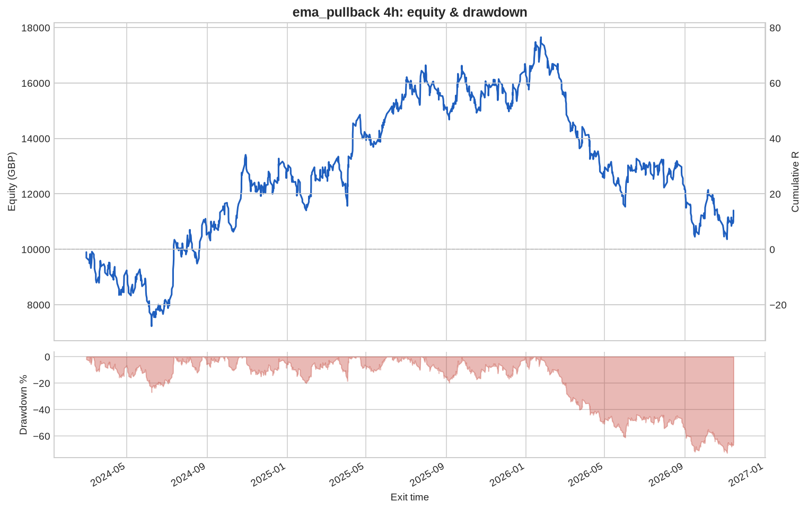
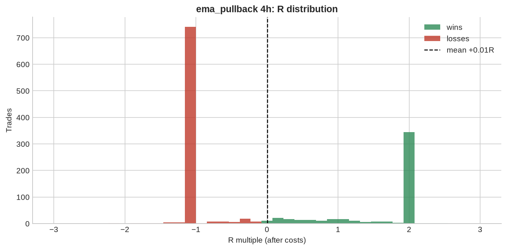

# ema_pullback 4h

**Parameters:** ema_fast=20, ema_mid=50, ema_slow=200, pullback_bars=3, rsi_max=70, sl_atr_buffer=0.5, rr=2.0, max_bars=48

**Costs modelled:** spread per instrument (config), slippage 0.2 pips/pts per side, commission 0.0 GBP/round trip, same-bar SL+TP → pessimistic.  
**Sizing:** 1.0% of GBP 10,000 per trade, fixed.

## Headline

| Metric | Value |
|---|---|
| Trades | 1,309 |
| Win rate | 38.3% |
| Expectancy (R) | 0.011 |
| Profit factor | 1.018 |
| Payoff ratio | 1.636 |
| Total R | 14.033 |
| Return % | 14.033 |
| Max drawdown (R) | 72.901 |
| Max drawdown % | 72.901 |
| Sharpe (daily) | 0.171 |
| t-stat of mean R | 0.292 |
| Avg bars held | 19.474 |
| Max consecutive losses | 14 |
| Trades / month | 40.046 |
| First trade | 2024-02-22 |
| Last trade | 2026-11-13 |

## By instrument

| instrument | trades | win_rate | expectancy_R | total_R | max_dd_R |
|---|---|---|---|---|---|
| AUDUSD | 108 | 0.370 | -0.034 | -3.716 | 19.692 |
| EURGBP | 105 | 0.333 | -0.140 | -14.730 | 20.141 |
| EURJPY | 127 | 0.339 | -0.059 | -7.530 | 20.934 |
| EURUSD | 126 | 0.389 | 0.043 | 5.437 | 16.048 |
| GBPJPY | 124 | 0.323 | -0.162 | -20.030 | 29.840 |
| GBPUSD | 115 | 0.348 | -0.059 | -6.795 | 11.291 |
| GER40 | 61 | 0.344 | -0.070 | -4.253 | 12.641 |
| JPN225 | 37 | 0.514 | 0.339 | 12.548 | 7.203 |
| NAS100 | 34 | 0.529 | 0.293 | 9.949 | 3.652 |
| SPX500 | 40 | 0.450 | 0.162 | 6.490 | 5.372 |
| UK100 | 55 | 0.436 | 0.187 | 10.263 | 11.113 |
| US30 | 41 | 0.439 | 0.125 | 5.137 | 4.939 |
| USDCAD | 101 | 0.406 | 0.089 | 8.993 | 9.549 |
| USDCHF | 119 | 0.412 | 0.053 | 6.277 | 29.119 |
| USDJPY | 116 | 0.405 | 0.052 | 5.994 | 10.680 |

## By year

| year | trades | win_rate | expectancy_R | total_R | max_dd_R |
|---|---|---|---|---|---|
| 2024 | 411 | 0.399 | 0.069 | 28.399 | 27.754 |
| 2025 | 479 | 0.405 | 0.072 | 34.414 | 19.652 |
| 2026 | 419 | 0.344 | -0.116 | -48.779 | 72.901 |

## By direction

| direction | trades | win_rate | expectancy_R | total_R | max_dd_R |
|---|---|---|---|---|---|
| long | 833 | 0.400 | 0.037 | 31.011 | 34.054 |
| short | 476 | 0.355 | -0.036 | -16.977 | 62.057 |

## By exit reason

| exit_reason | trades | win_rate | expectancy_R | total_R | max_dd_R |
|---|---|---|---|---|---|
| open_at_end | 10 | 0.800 | 0.465 | 4.646 | 0.310 |
| stop | 755 | 0.000 | -1.024 | -773.3 | 773.3 |
| target | 348 | 1.000 | 1.989 | 692.2 | 0.000 |
| time | 196 | 0.745 | 0.462 | 90.490 | 2.611 |

## By entry hour (UTC)

| entry_hour_utc | trades | win_rate | expectancy_R | total_R | max_dd_R |
|---|---|---|---|---|---|
| 0 | 93 | 0.280 | -0.266 | -24.778 | 25.476 |
| 4 | 237 | 0.418 | 0.125 | 29.693 | 18.092 |
| 8 | 220 | 0.341 | -0.097 | -21.351 | 30.416 |
| 12 | 259 | 0.402 | 0.098 | 25.388 | 17.311 |
| 16 | 383 | 0.407 | 0.056 | 21.635 | 26.982 |
| 20 | 117 | 0.359 | -0.141 | -16.554 | 18.007 |

## Monte Carlo (1000 runs)

| | p50 | p95 |
|---|---|---|
| Max drawdown, shuffled order (R) | 46.6 | 72.2 |
| Max drawdown, bootstrap (R) | 48.1 | 97.8 |

Bootstrap total R: p5 -64.6, p50 +16.9, p95 +98.8. Probability the edge is actually negative: **37%**.

---

_Backtests use mid/bid prices from free feeds, one position per instrument, no overnight financing, no margin limits. They are research, not a forecast and not advice._