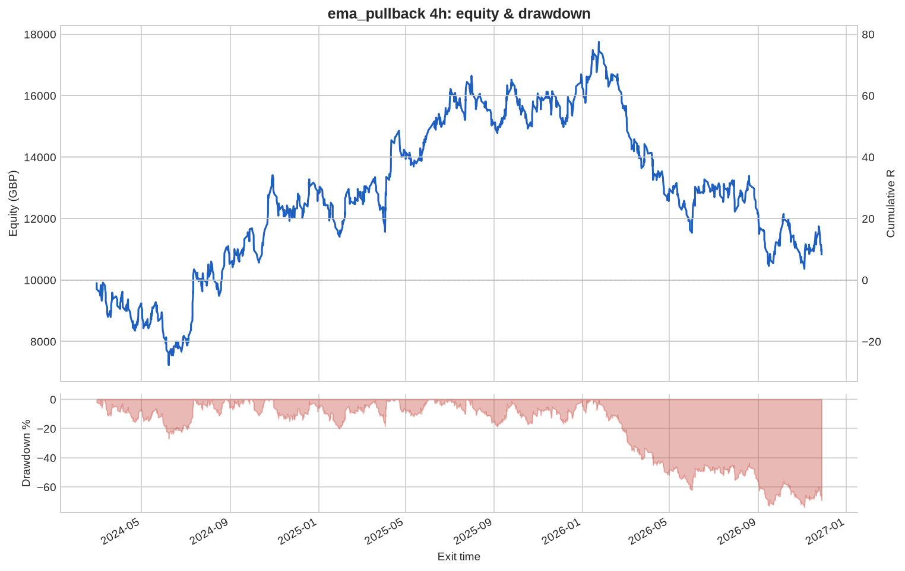
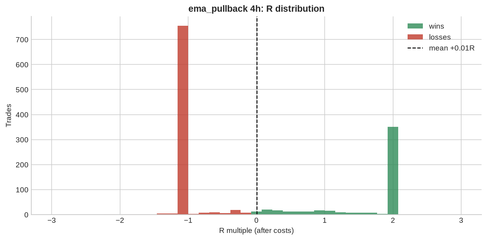

# ema_pullback 4h

**Parameters:** ema_fast=20, ema_mid=50, ema_slow=200, pullback_bars=3, rsi_max=70, sl_atr_buffer=0.5, rr=2.0, max_bars=48

**Costs modelled:** spread per instrument (config), slippage 0.2 pips/pts per side, commission 0.0 GBP/round trip, same-bar SL+TP → pessimistic.  
**Sizing:** 1.0% of GBP 10,000 per trade, fixed.

## Headline

| Metric | Value |
|---|---|
| Trades | 1,329 |
| Win rate | 38.1% |
| Expectancy (R) | 0.006 |
| Profit factor | 1.011 |
| Payoff ratio | 1.638 |
| Total R | 8.597 |
| Return % | 8.597 |
| Max drawdown (R) | 73.907 |
| Max drawdown % | 73.907 |
| Sharpe (daily) | 0.115 |
| t-stat of mean R | 0.177 |
| Avg bars held | 19.445 |
| Max consecutive losses | 14 |
| Trades / month | 40.094 |
| First trade | 2024-02-22 |
| Last trade | 2026-11-27 |

## By instrument

| instrument | trades | win_rate | expectancy_R | total_R | max_dd_R |
|---|---|---|---|---|---|
| AUDUSD | 109 | 0.367 | -0.034 | -3.760 | 19.691 |
| EURGBP | 107 | 0.327 | -0.161 | -17.223 | 20.141 |
| EURJPY | 129 | 0.341 | -0.042 | -5.453 | 20.929 |
| EURUSD | 127 | 0.394 | 0.049 | 6.259 | 16.053 |
| GBPJPY | 126 | 0.325 | -0.151 | -19.053 | 29.840 |
| GBPUSD | 117 | 0.359 | -0.041 | -4.796 | 11.291 |
| GER40 | 61 | 0.328 | -0.107 | -6.511 | 12.641 |
| JPN225 | 38 | 0.526 | 0.382 | 14.531 | 7.203 |
| NAS100 | 35 | 0.543 | 0.328 | 11.496 | 3.652 |
| SPX500 | 41 | 0.439 | 0.119 | 4.863 | 6.999 |
| UK100 | 56 | 0.411 | 0.137 | 7.645 | 11.113 |
| US30 | 42 | 0.405 | 0.071 | 3.000 | 4.939 |
| USDCAD | 102 | 0.402 | 0.078 | 7.971 | 9.549 |
| USDCHF | 120 | 0.408 | 0.044 | 5.266 | 30.088 |
| USDJPY | 119 | 0.403 | 0.037 | 4.362 | 10.680 |

## By year

| year | trades | win_rate | expectancy_R | total_R | max_dd_R |
|---|---|---|---|---|---|
| 2024 | 411 | 0.399 | 0.069 | 28.399 | 26.742 |
| 2025 | 479 | 0.405 | 0.072 | 34.414 | 18.644 |
| 2026 | 439 | 0.339 | -0.123 | -54.216 | 73.907 |

## By direction

| direction | trades | win_rate | expectancy_R | total_R | max_dd_R |
|---|---|---|---|---|---|
| long | 838 | 0.395 | 0.026 | 21.653 | 40.296 |
| short | 491 | 0.358 | -0.027 | -13.056 | 62.062 |

## By exit reason

| exit_reason | trades | win_rate | expectancy_R | total_R | max_dd_R |
|---|---|---|---|---|---|
| open_at_end | 8 | 0.625 | -0.096 | -0.768 | 1.653 |
| stop | 769 | 0.000 | -1.024 | -787.4 | 787.4 |
| target | 354 | 1.000 | 1.989 | 704.1 | 0.000 |
| time | 198 | 0.747 | 0.468 | 92.694 | 2.610 |

## By entry hour (UTC)

| entry_hour_utc | trades | win_rate | expectancy_R | total_R | max_dd_R |
|---|---|---|---|---|---|
| 0 | 95 | 0.284 | -0.239 | -22.683 | 24.448 |
| 4 | 241 | 0.419 | 0.123 | 29.679 | 18.092 |
| 8 | 221 | 0.339 | -0.101 | -22.363 | 31.428 |
| 12 | 261 | 0.398 | 0.082 | 21.498 | 17.311 |
| 16 | 389 | 0.404 | 0.052 | 20.358 | 25.001 |
| 20 | 122 | 0.352 | -0.147 | -17.892 | 19.085 |

## Monte Carlo (1000 runs)

| | p50 | p95 |
|---|---|---|
| Max drawdown, shuffled order (R) | 49.9 | 74.3 |
| Max drawdown, bootstrap (R) | 51.2 | 103.0 |

Bootstrap total R: p5 -75.0, p50 +8.0, p95 +87.3. Probability the edge is actually negative: **43%**.

---

_Backtests use mid/bid prices from free feeds, one position per instrument, no overnight financing, no margin limits. They are research, not a forecast and not advice._