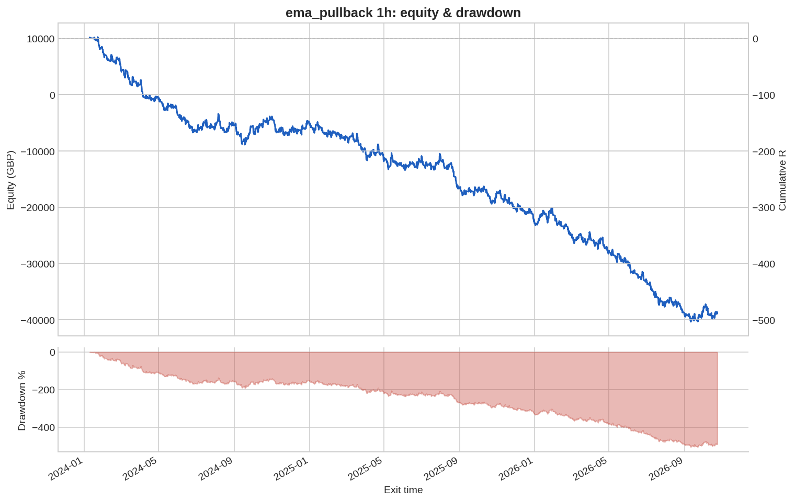
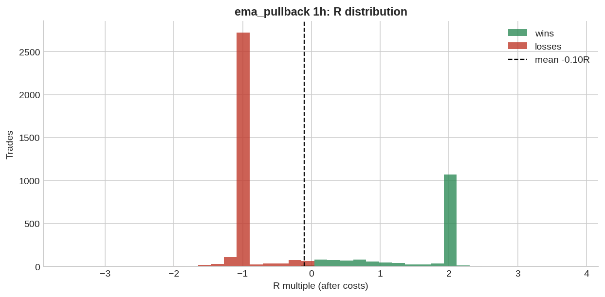

# ema_pullback 1h

**Parameters:** ema_fast=20, ema_mid=50, ema_slow=200, pullback_bars=3, rsi_max=70, sl_atr_buffer=0.5, rr=2.0, max_bars=48

**Costs modelled:** spread per instrument (config), slippage 0.2 pips/pts per side, commission 0.0 GBP/round trip, same-bar SL+TP → pessimistic.  
**Sizing:** 1.0% of GBP 10,000 per trade, fixed.

## Headline

| Metric | Value |
|---|---|
| Trades | 4813 |
| Win rate | 34.8% |
| Expectancy (R) | -0.102 |
| Profit factor | 0.844 |
| Payoff ratio | 1.579 |
| Total R | -488.6 |
| Return % | -488.6 |
| Max drawdown (R) | 506.2 |
| Max drawdown % | 506.2 |
| Sharpe (daily) | -2.447 |
| t-stat of mean R | -5.416 |
| Avg bars held | 20.165 |
| Max consecutive losses | 27 |
| Trades / month | 143.4 |
| First trade | 2024-01-05 |
| Last trade | 2026-10-23 |

## By instrument

| instrument | trades | win_rate | expectancy_R | total_R | max_dd_R |
|---|---|---|---|---|---|
| AUDUSD | 474 | 0.342 | -0.111 | -52.816 | 56.543 |
| EURGBP | 441 | 0.299 | -0.246 | -108.4 | 122.1 |
| EURJPY | 438 | 0.349 | -0.106 | -46.389 | 47.644 |
| EURUSD | 465 | 0.361 | -0.042 | -19.475 | 34.408 |
| GBPJPY | 444 | 0.336 | -0.115 | -50.997 | 64.069 |
| GBPUSD | 461 | 0.338 | -0.142 | -65.441 | 69.343 |
| GER40 | 159 | 0.352 | -0.071 | -11.252 | 20.966 |
| JPN225 | 109 | 0.422 | 0.147 | 15.998 | 8.131 |
| NAS100 | 122 | 0.377 | -0.060 | -7.340 | 12.900 |
| SPX500 | 129 | 0.380 | -0.030 | -3.836 | 14.393 |
| UK100 | 183 | 0.355 | -0.008 | -1.373 | 20.425 |
| US30 | 127 | 0.339 | -0.114 | -14.508 | 18.616 |
| USDCAD | 392 | 0.401 | 0.002 | 0.791 | 44.377 |
| USDCHF | 440 | 0.318 | -0.204 | -89.763 | 96.578 |
| USDJPY | 429 | 0.359 | -0.079 | -33.840 | 41.095 |

## By year

| year | trades | win_rate | expectancy_R | total_R | max_dd_R |
|---|---|---|---|---|---|
| 2,024.0 | 1,675.0 | 0.355 | -0.091 | -151.7 | 191.3 |
| 2,025.0 | 1,715.0 | 0.341 | -0.103 | -177.3 | 180.6 |
| 2,026.0 | 1,423.0 | 0.350 | -0.112 | -159.7 | 202.5 |

## By direction

| direction | trades | win_rate | expectancy_R | total_R | max_dd_R |
|---|---|---|---|---|---|
| long | 2791 | 0.365 | -0.066 | -183.5 | 190.6 |
| short | 2022 | 0.325 | -0.151 | -305.1 | 332.6 |

## By exit reason

| exit_reason | trades | win_rate | expectancy_R | total_R | max_dd_R |
|---|---|---|---|---|---|
| open_at_end | 9 | 0.556 | 0.029 | 0.260 | 0.646 |
| stop | 2904 | 0.000 | -1.050 | -3,048.7 | 3,048.7 |
| target | 1130 | 1.000 | 1.988 | 2,246.0 | 0.000 |
| time | 770 | 0.703 | 0.408 | 313.8 | 2.335 |

## By entry hour (UTC)

| entry_hour_utc | trades | win_rate | expectancy_R | total_R | max_dd_R |
|---|---|---|---|---|---|
| 0.000 | 142.0 | 0.345 | -0.056 | -7.894 | 17.397 |
| 1.000 | 266.0 | 0.414 | 0.083 | 22.104 | 14.469 |
| 2.000 | 160.0 | 0.338 | -0.109 | -17.449 | 32.832 |
| 3.000 | 137.0 | 0.307 | -0.220 | -30.102 | 33.150 |
| 4.000 | 143.0 | 0.301 | -0.178 | -25.512 | 34.222 |
| 5.000 | 125.0 | 0.392 | 0.087 | 10.898 | 10.946 |
| 6.000 | 151.0 | 0.318 | -0.132 | -19.928 | 31.333 |
| 7.000 | 212.0 | 0.354 | -0.012 | -2.478 | 20.617 |
| 8.000 | 350.0 | 0.320 | -0.179 | -62.556 | 64.116 |
| 9.000 | 262.0 | 0.286 | -0.267 | -69.836 | 75.886 |
| 10.000 | 214.0 | 0.383 | -0.007 | -1.539 | 18.489 |
| 11.000 | 183.0 | 0.317 | -0.158 | -28.888 | 41.374 |
| 12.000 | 226.0 | 0.350 | -0.106 | -23.883 | 24.542 |
| 13.000 | 306.0 | 0.425 | 0.038 | 11.483 | 23.804 |
| 14.000 | 386.0 | 0.355 | -0.118 | -45.624 | 57.210 |
| 15.000 | 406.0 | 0.367 | -0.090 | -36.340 | 52.566 |
| 16.000 | 278.0 | 0.399 | -0.029 | -8.189 | 35.788 |
| 17.000 | 187.0 | 0.369 | -0.086 | -16.076 | 26.396 |
| 18.000 | 179.0 | 0.341 | -0.065 | -11.620 | 35.327 |
| 19.000 | 178.0 | 0.309 | -0.173 | -30.814 | 40.349 |
| 20.000 | 131.0 | 0.290 | -0.270 | -35.425 | 49.203 |
| 21.000 | 92.000 | 0.228 | -0.426 | -39.167 | 39.167 |
| 22.000 | 46.000 | 0.304 | -0.174 | -8.012 | 12.026 |
| 23.000 | 53.000 | 0.283 | -0.222 | -11.760 | 17.618 |

## Monte Carlo (1000 runs)

| | p50 | p95 |
|---|---|---|
| Max drawdown, shuffled order (R) | 501.5 | 524.2 |
| Max drawdown, bootstrap (R) | 502.6 | 653.3 |

Bootstrap total R: p5 -641.0, p50 -486.4, p95 -340.9. Probability the edge is actually negative: **100%**.

## Walk-forward

In-sample 2024-01-01 → 2025-12-19, out-of-sample 2025-12-20 → 2026-10-23.

### Parameter grid (in-sample)

| rr | sl_atr_buffer | is_trades | is_expectancy_R | is_total_R | is_max_dd_R | score |
|---|---|---|---|---|---|---|
| 3.000 | 1.000 | 2,782.0 | -0.070 | -195.6 | 208.0 | -3.709 |
| 2.000 | 1.000 | 2,937.0 | -0.081 | -239.2 | 247.6 | -4.415 |
| 1.500 | 1.000 | 3,123.0 | -0.085 | -264.2 | 272.1 | -4.728 |
| 3.000 | 0.500 | 3,133.0 | -0.088 | -275.5 | 287.4 | -4.921 |
| 3.000 | 0.250 | 3,388.0 | -0.087 | -293.1 | 302.1 | -5.036 |
| 2.000 | 0.500 | 3,347.0 | -0.092 | -308.6 | 316.0 | -5.334 |
| 1.500 | 0.500 | 3,624.0 | -0.095 | -344.3 | 350.5 | -5.720 |
| 2.000 | 0.250 | 3,653.0 | -0.102 | -372.1 | 380.3 | -6.157 |
| 1.500 | 0.250 | 3,982.0 | -0.109 | -433.3 | 438.0 | -6.867 |

**Best in-sample params:** {'rr': 3.0, 'sl_atr_buffer': 1.0}

### Out-of-sample with best params

| Metric | Value |
|---|---|
| Trades | 1221 |
| Win rate | 35.5% |
| Expectancy (R) | -0.079 |
| Profit factor | 0.874 |
| Payoff ratio | 1.590 |
| Total R | -96.167 |
| Return % | -96.167 |
| Max drawdown (R) | 159.8 |
| Max drawdown % | 159.8 |
| Sharpe (daily) | -1.617 |
| t-stat of mean R | -1.995 |
| Avg bars held | 27.629 |
| Max consecutive losses | 20 |
| Trades / month | 121.9 |
| First trade | 2025-12-22 |
| Last trade | 2026-10-23 |

### Out-of-sample with default params

| Metric | Value |
|---|---|
| Trades | 1472 |
| Win rate | 34.5% |
| Expectancy (R) | -0.125 |
| Profit factor | 0.810 |
| Payoff ratio | 1.538 |
| Total R | -183.9 |
| Return % | -183.9 |
| Max drawdown (R) | 206.0 |
| Max drawdown % | 206.0 |
| Sharpe (daily) | -2.944 |
| t-stat of mean R | -3.702 |
| Avg bars held | 19.961 |
| Max consecutive losses | 17 |
| Trades / month | 146.9 |
| First trade | 2025-12-22 |
| Last trade | 2026-10-23 |

---

_Backtests use mid/bid prices from free feeds, one position per instrument, no overnight financing, no margin limits. They are research, not a forecast and not advice._